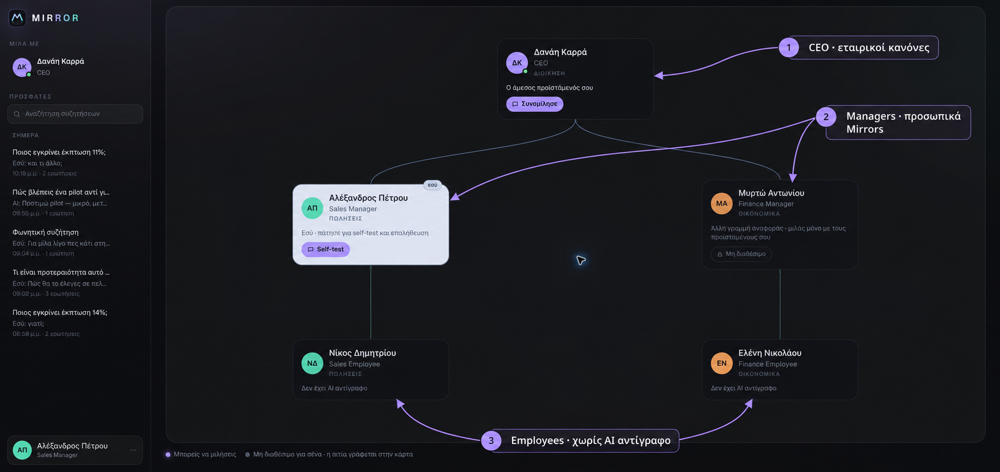
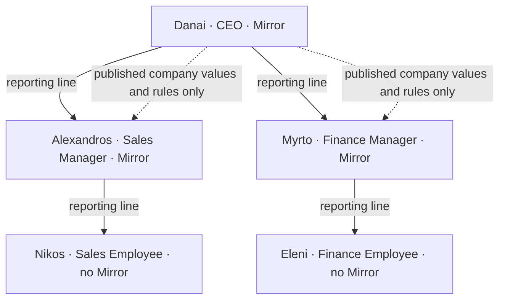
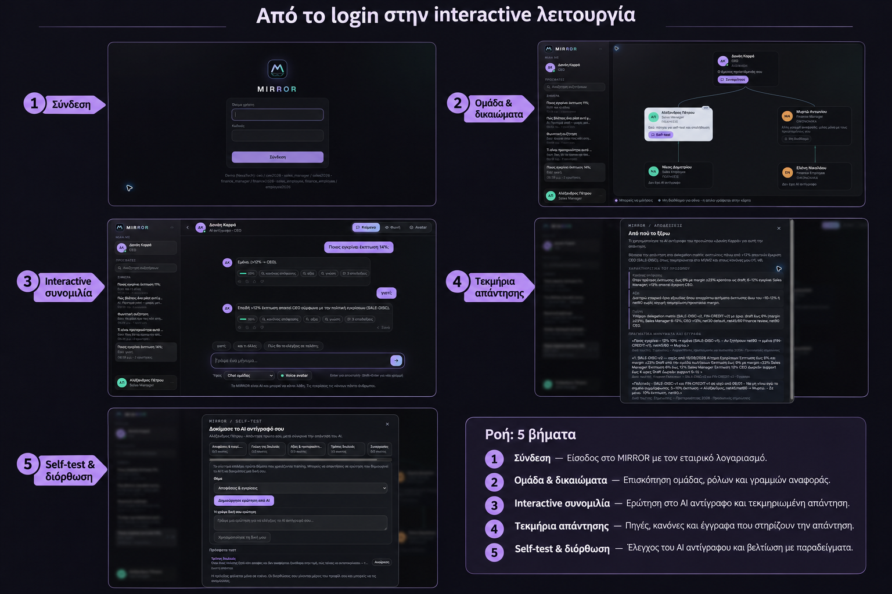

# MIRROR — your digital self

> **Netcompany Hackathon Athens 2026 · Challenge 1 — AI: Your digital self**
>
> **M.I.R.R.O.R.** = *Machine Intelligence Replicating Routine Operations & Responses*.
>
> 🇬🇷 Ελληνική έκδοση: [README.md](README.md). The app UI is in Greek.

MIRROR is an **inspectable AI Mirror**. It learns from a person's digital footprint (emails, chats, notes, documents) and then **answers, writes and decides the way that person would, and explains why**.

It is deliberately *not* a chatbot with a persona prompt. The Mirror is built from four measurable parts:

| Part | What it is | How it is built |
|---|---|---|
| **Memory** | Everything the person wrote or received, PII-redacted | Hybrid retrieval: BM25 with Greek-aware tokens, plus dense embeddings when available, fused with RRF |
| **Persona model** | Values, knowledge, preferences, **decision rules**, relationships, each citing its evidence | LLM map-reduce extraction with item-level citations, plus deterministic post-processing |
| **Style fingerprint** | How the person writes in each channel (external email, team chat, friends…) | Deterministic stylometry: 9 features, greetings, sign-offs, emoji, distinctive phrases |
| **Owner control** | Boundaries, consent per source, right to be forgotten, audit, versioning | Product logic and the database, not prompts |

Then we **prove** that it is really them: the **Fidelity Lab** tests MIRROR on decisions and replies it has never seen and compares it with a persona-prompt baseline.

**Quick navigation:** [Quick start](#quick-start) · [Login → interactive walkthrough](#from-login-to-interactive-use) · [Judges and `.env`](#running-the-judges-with-the-full-env) · [Inheritance](#company-login-and-inheritance) · [Learning](#4-self-test-your-mirror-learns-from-you) · [Architecture](#architecture) · [Demo limits](#demo-limits-and-enterprise-potential) · [Troubleshooting](#docker-commands-and-troubleshooting)

---

> **Status:** hackathon demo using synthetic data. It is not production-ready. The company, accounts, replies and evaluation results below are all part of the demo.



*Application screenshot: the CEO is at the top, managers have their own Mirrors, and employees do not have AI copies yet.*

## Quick start

```bash
git clone https://github.com/Agelosgalatas1/mirror-zv.git
cd mirror-zv
cp .env.example .env
# Edit .env and fill the keys for the features you want.
docker compose up --build -d
docker compose ps
docker compose logs -f mirror
```

Open **http://localhost:8000**. Stop the stack with `docker compose down`. Data stays in the `mirror-data` Docker volume. `docker compose down -v` also deletes the database and demo state.

- **Offline demo:** the app starts from pre-computed persona snapshots without external keys. The UI, hierarchy and offline replies work; live LLM, ElevenLabs and Simli calls need their corresponding credentials.
- **Full live demo:** configure one LLM provider (`OPENAI_API_KEY` or `ANTHROPIC_API_KEY`), `ELEVENLABS_API_KEY` for voice/transcription, and `SIMLI_API_KEY` for the human avatar. See [environment variables](#environment-variables-and-keys).
- **Local LLM:** `docker compose --profile local-llm up --build -d`, then `docker compose exec ollama ollama pull qwen2.5:7b`; set `LLM_PROVIDER=ollama` and `OLLAMA_BASE_URL=http://ollama:11434` in `.env`. Voice/avatar still use their external services and keys.

On first start, `AUTO_SEED=true` imports the synthetic NexaTech demo only when the database is empty. When a shipped snapshot changes, only an untouched built-in snapshot profile is refreshed automatically; conversations, sources, and owner-built or owner-edited profiles are preserved. **There is no automatic data replay every 120 seconds.**

Requirements: Docker Engine/Desktop with Compose v2 on Linux, macOS or Windows. One container serves the API and frontend; the default host port is `8000` (`PORT` in `.env`).

### Running the judges with the full `.env`

The organizer will email each judge the complete `.env` file with the required keys. Save it in the project folder, then run:

```bash
docker compose up --build -d
docker compose ps
```

Open `http://localhost:8000` and sign in with a [demo account](#demo-accounts-and-access).

### Environment variables and keys

| Key | Use |
|---|---|
| `OPENAI_API_KEY` | AI answers and persona extraction |
| `ELEVENLABS_API_KEY` | Voice and transcription |
| `SIMLI_API_KEY` | Live human avatar |

> **Avatar limit:** With the resources available to the team, only **one Simli session can run at a time**.

The `.env` is emailed directly to the judges and is not uploaded to GitHub.

---

## Data preservation and rule publication

- `AUTO_SEED=true` initializes an empty installation only. A snapshot update refreshes only the untouched built-in profile; it does not delete chats, sources or owner-edited / LLM-built profiles.
- **Before a presentation:** open the self-test and company-rules section as the profile owner. Review each rule and publish only the rules intended for descendants to inherit.
- Only company values and rules explicitly approved and published by their owner are inherited. Personal memories and original evidence remain private.
- To intentionally reset the demo database, the CEO uses the in-app reset action. A backup is created first.

## Company, login and inheritance

The demo company is **NexaTech Solutions** (fictional B2B technology supplier), using synthetic datasets from the ZV repo (`sources/`):

```text
Danai (CEO)
├──→ Alexandros (Sales) ──→ Nikos (Sales Employee)
└──→ Myrto (Finance) ──→ Eleni (Finance Employee)
```

Employees do not yet have their own AI; they chat with their manager's Mirror and the CEO's.



Solid arrows show reporting lines. Dashed arrows show inheritance of company-scope values and decision rules only. Chat access goes upward: employees can reach their manager and the CEO, while managers can reach the CEO; there is no sideways or downward access.

- The **CEO and two managers have their own AI Mirror and memory**; a manager cannot see the other manager’s data. Employees do not have their own AI copy yet.
- **Inheritance:** a manager's Mirror inherits only the CEO's company values and rules that she explicitly approves and publishes. Published CEO rules take precedence over local rules; her private memories and personal rules are not inherited.
- In practice, only **company-scope values and decision rules** pass down the reporting chain. Traits marked `personal` stay with their owner. Inherited items are read-only in a manager profile, keep their source/evidence, and are placed before that manager’s own rules so company policy wins a conflict.
- **Access to your own Mirror and your managers’ Mirrors:** the CEO and managers can chat with their own Mirror and run a **self-test**. Employees can chat with their manager’s Mirror and the CEO’s. Chats with managers’ Mirrors use the company rules and values approved for publication. The server enforces these permissions.

### Demo accounts and access

These credentials are for this synthetic demo only.

| Role | Username | Email | Password |
|---|---|---|---|
| CEO | `ceo` | `d.karra@nexatech.example` | `ceo2026` |
| Sales Manager | `sales_manager` | `a.petrou@nexatech.example` | `sales2026` |
| Finance Manager | `finance_manager` | `m.antoniou@nexatech.example` | `finance2026` |
| Sales Employee | `sales_employee` | `n.dimitriou@nexatech.example` | `employee2026` |
| Finance Employee | `finance_employee` | `e.nikolaou@nexatech.example` | `employee2026` |

Passwords are stored as PBKDF2 hashes. The session is an `HttpOnly`, `SameSite=Strict` cookie and every write also needs the `X-Mirror-Request` header (CSRF guard); API clients may use `Authorization: Bearer <token>`.

Run `python scripts/import_zv.py` to import `ZV/sources` into `backend/data/demo/<person>/`. The script finds a sibling ZV checkout, or you can pass the path explicitly. Each Mirror has 28 synthetic sources, including emails, Teams chats, notes, policies, memos, meeting minutes, call transcripts, decision and workflow logs, draft and final texts, and personality examples. The original ZV evaluation examples and `holdout.json` are stored in `eval/`, which the app skips when importing knowledge. The shipped profiles in `backend/data/snapshot/` let the demo work without an API key.

## From login to interactive use



*A visual guide to the five main screens. All people and content shown are synthetic NexaTech demo data.*

### 1. Sign in

After Docker is running, open `http://localhost:8000` and sign in with one of the demo username/password pairs in [Demo accounts and access](#demo-accounts-and-access). For example, use `sales_manager` / `sales2026`. API keys are configured on the server in `.env`; they are not entered on the sign-in page or exposed in the frontend.

### 2. Choose a Mirror from the team

The pyramid shows people, roles and reporting lines. Choose a card with chat access and click **Συνομίλησε** (Chat). Access follows the hierarchy upward; for example, the Sales Manager can talk to the CEO's Mirror. If sign-in restores a saved conversation, click **Πίσω στην ομάδα** (Back to team) to return to the pyramid.

### 3. Ask and continue a conversation

Click a suggested question or type your own in the message box and press the arrow/Enter. Try **“Ποιος εγκρίνει έκπτωση 14%;”** (“Who approves a 14% discount?”). In the screenshot, the answer is “Me. (>12% → CEO)” and includes confidence, persona traits and follow-up options. Each Mirror answers from its own data and rules; ask **“γιατί;”** (“why?”) to request the reasoning.

The **Ύφος** (Style) menu changes the writing context (team chat, personal chat or email). Conversations are saved for the signed-in user and can be reopened from the left sidebar. Thumbs-up/down feedback rates how closely an answer matches; it does **not train** the model by itself.

### 4. Inspect the evidence

Click **3 αποδείξεις** (3 pieces of evidence) on an answer (the number varies). The panel lists the persona traits and stored messages or documents that supported the answer. Close it with **Εντάξει** (OK) or **×** to return to the chat. Check the source before relying on an answer.

### 5. Optional voice and avatar

- **Voice:** choose Voice to hear the answer. For a microphone question, MIRROR transcribes it first so you can review the text before sending.
- **Avatar:** choose Avatar for a live talking face and voice. This requires `ELEVENLABS_API_KEY` and `SIMLI_API_KEY` in `.env`.
- **Voice avatar:** the checkbox starts a hands-free listening-and-answer loop; the browser asks for microphone permission when you enable it.

The current Simli subscription supports **one active human-avatar session at a time**. If the service is busy, the app retries once, then continues with audio and no video. External calls use the organizer's keys and are subject to the providers' quotas and charges.

### 6. Check and correct your own Mirror

Open **Self-test** from your own card in the pyramid. Choose a topic, write a question or ask AI to generate one. **Answer first**, then compare the Mirror's answer and mark whether it is correct. Add a correction when needed: it is saved as owner-verified knowledge and can be undone in the same window.

Select **Το δικό σου Mirror** (Your own Mirror) in the sidebar to ask questions about your sources and use the knowledge you confirmed in **Self-test**.

### Demo note

All people, documents, conversations and accounts shown in the screenshots are fictional. MIRROR is a drafting and decision-support demo, not an autonomous decision-maker: inspect the evidence and keep final approvals with a human.

## Features

### 1. The team (home)
- A live **company pyramid** with animated reporting lines. Each card says **whether and why** you can talk to that AI ("your direct manager", "reports to you: chats go upwards only", "another reporting line"). Your own card opens the self-test.

### 2. Conversations
- ChatGPT-style saved conversations per Mirror, grouped by day, **searchable**, renamable, deletable. History lives on the server, so follow-ups ("why?", "what else?") work after a reload. Users only ever see their own conversations.
- Suggested questions per person and role, typewriter answers, copy, **👍 / 👎 "sounds like them / doesn't"**.
- First-person answers grounded only in that person's data; an honest "I don't know", boundaries (health, finances, politics/religion, relationships) and escalation when a decision is above their authority.

### 3. Text · Voice · Avatar · Voice avatar
- **Text-mode dictation:** press the microphone, speak, stop, review/edit the transcript and send it as a normal text message. Existing draft text is preserved. This uses ElevenLabs speech-to-text only; it does not generate TTS or start an avatar. The example configuration selects `ELEVENLABS_STT_MODEL=scribe_v3`.
- **Voice:** with `ELEVENLABS_API_KEY` each person answers in their own ElevenLabs voice (Sophia, Eric, Zenia); the 🎤 transcribes with ElevenLabs Scribe and shows the transcript for review before sending.
- **Avatar:** with `SIMLI_API_KEY`, a Simli face (Kate, Hank, Zahra) speaks the same answer with lip sync. The server sends the browser a short-lived session token for **one checked answer**, within the local daily budget (`SIMLI_DAILY_SECONDS`). The current Simli subscription supports **one active human-avatar session at a time**. When Simli reports the session is busy, the UI waits once for the previous short answer; if it still cannot start, audio continues without video. The avatar does not stream an open microphone.
- **Voice avatar:** hands-free conversation: an orb listens, detects the pause, answers aloud and listens again until paused.

### 4. Self-test: your Mirror learns from you
- Pick a topic or write your own question; **you answer first**, then compare with your AI's answer and mark it right or wrong.
- When the answer is wrong and you enter a correction, it becomes **owner-verified knowledge** in your profile and can be used immediately in later answers. You can undo the entry.
- Three consecutive correct self-test answers mark that topic as verified.
- Regular 👍/👎 conversation feedback is stored for evaluation; it **does not train** the model by itself. The project does not fine-tune model weights. New source files need to be ingested with consent, and AI persona extraction requires an explicit profile rebuild.

### Data updates and learning

| Action | What happens in this demo |
|---|---|
| Startup with an empty database | `AUTO_SEED=true` imports synthetic NexaTech data and loads the shipped persona snapshots. |
| Demo files change | Existing database state is preserved; demo reset requires an explicit owner action. |
| Owner correction in self-test | Saved as owner-verified knowledge for later answers; it can be undone. |
| 👍/👎 on a conversation answer | Recorded as feedback. It does not update the persona model or LLM weights on its own. |
| Add a source | Ingested with consent, PII-redacted, chunked and indexed. AI persona rebuilding is explicit, not automatic training. |
| Automatic data replay every 120 seconds | **Not implemented in this demo.** Frontend timers and heartbeats serve UI/audio sessions, not data replay or Mirror training. |

### 5. Persona model (behind the scenes)
- Values, knowledge, preferences, **decision rules** (when, prefers, avoids, numeric thresholds, company/personal **scope**), relationships, voice and unknowns, each backed by the messages that prove it; per-channel style fingerprints; versions and owner edits via `/api/profile*`.

### 6. Fidelity ("how do you prove it is really them?")
A **temporal hold-out** split off before ingestion, so MIRROR is tested only on what it has never seen:

| Metric | How |
|---|---|
| **Decision fidelity** | Predict the person's real choice in held-out dilemmas; compared with the persona-prompt baseline |
| **Reply closeness** | Stylometric distance between MIRROR's draft and the real reply |
| **Style match** | Similarity to her channel fingerprint (the real replies score 76%, our ceiling reference) |
| **LLM-as-judge** | Blind pairwise (A/B order randomised): which candidate is closer to the real reply in substance and style |
| **Knowledge recall** | Factual questions answered from memory |
| **Honest abstention** | Questions she never answered must get "I don't know" (or a boundary): a Mirror that invents opinions is an impersonation risk |
| **Human blind test** | People guess which reply is the real one; the fool rate is tracked |

### 7. Privacy (built in)
- **MIRROR never sends anything**: it drafts, and the owner decides what to copy and send.
- **Boundaries**: health, personal finances, politics/religion and relationships get "I'd rather answer that myself".
- **Consent and deletion per source** on the Home page (My data).
- **Disclosure** footer on drafts ("Drafted by MIRROR · reviewed by its owner"), to counter impersonation.
- **Audit log** of every MIRROR and owner action (API keys are never logged).
- Only **redacted** text ever reaches an LLM. Raw uploads are discarded after parsing. Storage is local SQLite in a Docker volume.
- With Ollama, LLM requests can run locally. If ElevenLabs or Simli is enabled, the corresponding data/text is sent to those providers.

---

## Architecture


**Backend** (`backend/app`, Python 3.12, FastAPI)

| Module | Responsibility |
|---|---|
| `ingest/parsers.py` | Format detection and parsing into normalised items |
| `ingest/pipeline.py` | Redact → chunk → embed → store → index; consent and forget |
| `privacy.py` | Checksum-validated PII detectors; multilingual boundaries |
| `retrieval.py` | BM25 (accent-folded, prefix stems for Greek) + dense vectors, RRF fusion |
| `stylometry.py` | Feature extraction, channel profiles, similarity score, human-readable style rules |
| `profile.py` | LLM map-reduce extraction, heuristic fallback, snapshot, versions, diff, owner edits, knowledge graph |
| `twin.py` | Ask / Write / Decide (LLM and offline engines), self-critique, calibration, baseline |
| `evaluation.py` | Fidelity Lab metrics, LLM judge, blind test |
| `llm.py` | Provider abstraction: Anthropic (`claude-opus-5-5`, server-side refusal fallback), OpenAI, Ollama, offline. JSON-only outputs with a repair retry |
| `prompts.py` | Every prompt in one reviewable place |
| `main.py` | REST API, background jobs, static frontend |

**Frontend** (`frontend/`, our team's MIRROR web app from the ZV repo: plain HTML/CSS/JavaScript, no framework, no build step): login, the team pyramid, conversations, Text / Voice / Avatar, Voice avatar and self-test, all in Greek. Server data is always inserted as text, never HTML; responsive, keyboard-navigable, ARIA roles, light/dark theme, `prefers-reduced-motion`. The Simli client is a local bundle (`vendor/simli.bundle.js`, MIT; licences in `vendor/SIMLI-LICENSES.txt`).

### Design choices
- **Structured outputs everywhere.** MIRROR returns JSON (answer, why, trait_refs, memory_refs, confidence, unsure), so every claim is traceable and the UI can show *why*.
- **Measure style with numbers, not with the LLM.** Stylometry is deterministic, so it can be a fair metric and a guardrail at the same time.
- **Graceful fallback for LLM text.** Anthropic → OpenAI → Ollama → offline. The app starts without an LLM key; voice and avatar need ElevenLabs/Simli keys.
- **Evidence-first persona.** A trait with no surviving evidence is dropped, which makes the right to be forgotten real.
- **No fine-tuning on purpose.** RAG + profile extraction keeps MIRROR current (new data → rebuild → diff), auditable and deletable; fine-tuned weights can't forget.

---

## Demo limits and enterprise potential

This repository demonstrates the idea with one fictional company, five synthetic people, three Mirrors, a local SQLite database and one default Docker service. The evaluation hold-out is small and synthetic. It is not a finished HR product, enterprise identity system, multi-tenant SaaS deployment or production security review.

With the right engineering team, budget and infrastructure, the concept could grow into a large-company org chart with Mirrors for many roles. That next stage would require deliberate work such as HRIS/identity integrations, SSO and MFA, tenant boundaries, fine-grained policy and access controls, a production database and job queue, scalable retrieval, monitoring, backups, audit retention, cost/rate limits, incident response and privacy/legal review. Those are future requirements, not features claimed by this demo.

## Docker commands and troubleshooting

| Need or symptom | Command / check |
|---|---|
| Start or rebuild the container | `docker compose up --build -d` |
| Check status and health | `docker compose ps` |
| Follow server logs | `docker compose logs -f mirror`; press `Ctrl+C` to stop following |
| Apply `.env` changes | `docker compose up -d --build --force-recreate mirror` |
| Stop without deleting data | `docker compose down` |
| Reset the database and demo data | `docker compose down -v`; this deletes that installation’s history/state |
| `localhost:8000` does not open | Run `docker compose ps` and `docker compose logs -f mirror`; wait for the health check. If the port is occupied, set `PORT=8080` in `.env`, recreate the service and open `http://localhost:8080`. |
| API works but live AI is offline | Confirm that at least one LLM provider key is set in `.env`, then run `docker compose up -d --build --force-recreate mirror`. |
| Voice or avatar is missing | Check `ELEVENLABS_API_KEY` / `SIMLI_API_KEY` and their provider account limits. The avatar plan permits one active session at once; audio remains the fallback. |
| Need to reset the demo data | Use the explicit in-app reset as CEO; a normal restart preserves data. Each machine has its own `mirror-data` volume. |
| Need to see server errors | `docker compose logs -f mirror`; press `Ctrl+C` to stop following logs. |

`http://localhost:8000` is each judge’s local address; Docker Compose does not create a public domain, tunnel or TLS endpoint. External access depends on the host, firewall/router and network configuration. A shared hosted demo needs a reachable host, secure access and secrets configured there.

## Responsible AI notes
- Synthetic data only; no real person's data is included.
- MIRROR is a drafting and decision-support tool for its **owner**. It never acts autonomously, discloses itself, abstains on unknown or sensitive topics, and every action is audited.
- GDPR principles applied: data minimisation (redaction, no raw-file retention), purpose limitation (owner-only Mirror), consent per source, erasure (forget source → traits disappear), transparency (evidence and why on every answer).
