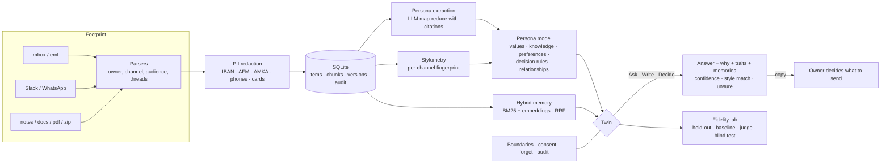

# MIRROR — your digital self

> **Netcompany Hackathon Athens 2026 · Challenge 1 — AI: Your digital self**
>
> *MIRROR*: a reflection of a person, with the evidence behind it.
>
> 🇬🇷 Ελληνική έκδοση: [README.md](README.md). The app UI is in Greek.

MIRROR is an **inspectable AI digital twin**. It learns from a person's digital footprint (emails, chats, notes, documents) and then **answers, writes and decides the way that person would, and explains why**.

It is deliberately *not* a chatbot with a persona prompt. The twin is built from four measurable parts:

| Part | What it is | How it is built |
|---|---|---|
| **Memory** | Everything the person wrote or received, PII-redacted | Hybrid retrieval: BM25 with Greek-aware tokens, plus dense embeddings when available, fused with RRF |
| **Persona model** | Values, knowledge, preferences, **decision rules**, relationships, each citing its evidence | LLM map-reduce extraction with item-level citations, plus deterministic post-processing |
| **Style fingerprint** | How the person writes in each channel (external email, team chat, friends…) | Deterministic stylometry: 9 features, greetings, sign-offs, emoji, distinctive phrases |
| **Owner control** | Boundaries, consent per source, right to be forgotten, audit, versioning | Product logic and the database, not prompts |

Then we **prove** that it is really them: the **Fidelity Lab** tests the twin on decisions and replies it has never seen and compares it with a persona-prompt baseline.

---

## Quick start

```bash
git clone <this repo> && cd mirror
cp .env.example .env          # optional: add ANTHROPIC_API_KEY or OPENAI_API_KEY
docker compose up --build
```

Open **http://localhost:8000**. That's it.

- **No key? It still works.** Without an LLM key, MIRROR runs its **offline rule-based engine** over a pre-computed persona snapshot. The UI, persona, decisions, nearest-neighbour replies, evaluation, privacy and control all work, so the container never fails because a key is missing.
- **With a key** (`ANTHROPIC_API_KEY` → Claude `claude-opus-5-5`, or `OPENAI_API_KEY` → `gpt-5-mini`), you get generated replies, the self-critique loop, live persona extraction ("Rebuild persona"), LLM-as-judge and embeddings (OpenAI).
- You can also paste a key **at runtime** from the UI (the status button at the bottom left). Keys stay in memory only.
- **Fully local option:** `docker compose --profile local-llm up --build`, then `docker compose exec ollama ollama pull qwen2.5:7b`, and set `LLM_PROVIDER=ollama`, `OLLAMA_BASE_URL=http://ollama:11434` in `.env`.

The first start seeds the **synthetic company NexaTech Solutions** (see below), so the demo works immediately. Data persists in the `mirror-data` Docker volume and is preserved when bundled demo files or snapshots change. Startup never resets a populated database. `docker compose down -v` deletes the data volume and is not an upgrade step.

Requirements: Docker with Compose v2 (Linux, macOS or Windows). The image is `python:3.12-slim-bookworm` with the frontend built in a `node:20-bookworm-slim` stage, and runs on amd64 and arm64.

---

## Company, login and inheritance

The demo company is **NexaTech Solutions** (fictional B2B technology supplier), built from our team's synthetic datasets (ZV repo, `sources/`). A three-level pyramid as in ZV: **Danai Karra (CEO)**; **Alexandros Petrou (Sales Manager)** and **Myrto Antoniou (Finance Manager)** reporting only to her; and under them **Nikos Dimitriou (Sales Employee)** and **Eleni Nikolaou (Finance Employee)**. Employees have no AI of their own yet: they chat with their manager's Mirror and the CEO's.

- **Everyone has their own AI counterpart (a "Mirror")** and their own memory; a manager never sees the other manager's data.
- **Inheritance:** a manager's Mirror inherits only company values and decision rules explicitly reviewed and published by the CEO (no exclusivity deals, >12% discount and net90 only by the CEO, a human always sends the final offer). On conflict the CEO's rule wins and the AI says where it came from. The CEO's personal rules are not inherited.
- **Upward-only access, enforced on the server:** a manager chats with the CEO's Mirror, never sideways. The CEO is at the top, so she runs the **self-test** on her own Mirror.

| Role | Username | Email | Password |
|---|---|---|---|
| CEO | `ceo` | `d.karra@nexatech.example` | `ceo2026` |
| Sales Manager | `sales_manager` | `a.petrou@nexatech.example` | `sales2026` |
| Finance Manager | `finance_manager` | `m.antoniou@nexatech.example` | `finance2026` |
| Sales Employee | `sales_employee` | `n.dimitriou@nexatech.example` | `employee2026` |
| Finance Employee | `finance_employee` | `e.nikolaou@nexatech.example` | `employee2026` |

Passwords are stored as PBKDF2 hashes. The session is an `HttpOnly`, `SameSite=Strict` cookie and every write also needs the `X-Mirror-Request` header (CSRF guard); API clients may use `Authorization: Bearer <token>`.

**Data** (`python scripts/import_zv.py <ZV>/sources` → `backend/data/demo/<person>/`, 100% synthetic): per person 10 emails (.eml), Teams chats, notes, policies (SALE-DISC v1/v2, FIN-CREDIT v1/v2, FIN-PROC-03), memos, meeting minutes, call transcripts, the 2026 decision log, CRM/ERP workflow logs, draft-vs-final texts and two personality-seed emails. `eval/holdout.json` is **never ingested**: the 12 November 2026 examples (4 decisions, 3 replies) plus 4 knowledge and 3 must-say-"I don't know" questions. The shipped persona models (`backend/data/snapshot/`) were extracted from this data with `python -m tools.build_snapshots`, so the demo also works without a key.

## Features

### 1. The team (home)
- A live **company pyramid** with animated reporting lines. Each card says **whether and why** you can talk to that AI ("your direct manager", "reports to you: chats go upwards only", "another reporting line"). Your own card opens the self-test.

### 2. Conversations
- ChatGPT-style saved conversations per Mirror, grouped by day, **searchable**, renamable, deletable. History lives on the server, so follow-ups ("why?", "what else?") work after a reload. Users only ever see their own conversations.
- Suggested questions per person and role, typewriter answers, copy, **👍 / 👎 "sounds like them / doesn't"**.
- First-person answers grounded only in that person's data; an honest "I don't know", boundaries (health, finances, politics/religion, relationships) and escalation when a decision is above their authority.

### 3. Text · Voice · Avatar · Voice avatar
- **Voice:** with `ELEVENLABS_API_KEY` each person answers in their own ElevenLabs voice (Sophia, Eric, Zenia); the 🎤 transcribes with ElevenLabs Scribe and shows the transcript for review before sending.
- **Avatar:** with `SIMLI_API_KEY` a live Simli face (Kate, Hank, Zahra) speaks the same audio with lip-sync. The browser only gets a short-lived token for **one checked answer**, under a local daily budget (`SIMLI_DAILY_SECONDS`); on any failure the answer plays as audio.
- **Voice avatar:** hands-free conversation: an orb listens, detects the pause, answers aloud and listens again until paused.

### 4. Self-test: your Mirror learns from you
- Pick a topic or write your own question; **you answer first**, then compare with your AI's answer and mark it right or wrong.
- A **correction becomes owner-verified knowledge** in your profile and is used from then on; every correction can be undone. Three right answers in a row mark a topic **verified**.

### 5. Persona model (behind the scenes)
- Values, knowledge, preferences, **decision rules** (when, prefers, avoids, numeric thresholds, company/personal **scope**), relationships, voice and unknowns, each backed by the messages that prove it; per-channel style fingerprints; versions and owner edits via `/api/profile*`.

### 6. Fidelity ("how do you prove it is really them?")
A **temporal hold-out** split off before ingestion, so the twin is tested only on what it has never seen:

| Metric | How |
|---|---|
| **Decision fidelity** | Predict the person's real choice in held-out dilemmas; compared with the persona-prompt baseline |
| **Reply closeness** | Stylometric distance between the twin's draft and the real reply |
| **Style match** | Similarity to her channel fingerprint (the real replies score 76%, our ceiling reference) |
| **LLM-as-judge** | Blind pairwise (A/B order randomised): which candidate is closer to the real reply in substance and style |
| **Knowledge recall** | Factual questions answered from memory |
| **Honest abstention** | Questions she never answered must get "I don't know" (or a boundary): a twin that invents opinions is an impersonation risk |
| **Human blind test** | People guess which reply is the real one; the fool rate is tracked |

Offline results on the demo persona (rule-based engine, no LLM), reproducible with `docker compose up` → Fidelity lab → Run:

| | Twin | Persona-prompt baseline |
|---|---|---|
| Held-out decisions predicted | **100%** | 16.7%* |
| Reply closeness to the real reply | **70.7%** | 49.1%* |
| Knowledge recall | **100%** | – |
| Honest abstention | **100%** | – |
| Fidelity index | **92.7** | – |

\* Offline, the baseline is a trivial "first option / generic polite reply". With an LLM configured, the baseline is the **same LLM** with a persona prompt and the judge win rate is added. Run it with your key to get live numbers.

### 7. Privacy (built in)
- **The twin never sends anything**: it drafts, and the owner decides what to copy and send.
- **Boundaries**: health, personal finances, politics/religion and relationships get "I'd rather answer that myself".
- **Consent and deletion per source** on the Home page (My data).
- **Disclosure** footer on drafts ("Drafted by a digital twin · reviewed by its owner"), to counter impersonation.
- **Audit log** of every twin and owner action (API keys are never logged).
- Only **redacted** text ever reaches an LLM. Raw uploads are discarded after parsing. Storage is local SQLite in a Docker volume.
- An **Ollama profile** keeps everything on-premise.

---

## Architecture



**Backend** (`backend/app`, Python 3.12, FastAPI)

| Module | Responsibility |
|---|---|
| `ingest/parsers.py` | Format detection and parsing into normalised items |
| `ingest/pipeline.py` | Redact → chunk → embed → store → index; consent and forget |
| `privacy.py` | Checksum-validated PII detectors; multilingual boundaries |
| `retrieval.py` | BM25 (accent-folded, prefix stems for Greek) + dense vectors, RRF fusion |
| `stylometry.py` | Feature extraction, channel profiles, similarity score, human-readable style rules |
| `profile.py` | LLM map-reduce extraction, heuristic fallback, snapshot, versions, diff, owner edits, knowledge graph |
| `twin.py` | Ask / Write / Decide (LLM and offline engines), self-critique, calibration, baseline |
| `evaluation.py` | Fidelity Lab metrics, LLM judge, blind test |
| `llm.py` | Provider abstraction: Anthropic (`claude-opus-5-5`, server-side refusal fallback), OpenAI, Ollama, offline. JSON-only outputs with a repair retry |
| `prompts.py` | Every prompt in one reviewable place |
| `main.py` | REST API, background jobs, static frontend |

**Frontend** (`frontend/`, our team's MIRROR web app from the ZV repo: plain HTML/CSS/JavaScript, no framework, no build step): login, the team pyramid, conversations, Text / Voice / Avatar, Voice avatar and self-test, all in Greek. Server data is always inserted as text, never HTML; responsive, keyboard-navigable, ARIA roles, light/dark theme, `prefers-reduced-motion`. The Simli client is a local bundle (`vendor/simli.bundle.js`, MIT; licences in `vendor/SIMLI-LICENSES.txt`).

### Design choices
- **Structured outputs everywhere.** The twin returns JSON (answer, why, trait_refs, memory_refs, confidence, unsure), so every claim is traceable and the UI can show *why*.
- **Measure style with numbers, not with the LLM.** Stylometry is deterministic, so it can be a fair metric and a guardrail at the same time.
- **Graceful degradation.** Anthropic → OpenAI → Ollama → offline. The container never fails because a key is missing, and every feature has an offline path.
- **Evidence-first persona.** A trait with no surviving evidence is dropped, which makes the right to be forgotten real.
- **No fine-tuning on purpose.** RAG + profile extraction keeps the twin current (new data → rebuild → diff), auditable and deletable; fine-tuned weights can't forget.

---

## API (selection)

| Method | Path | |
|---|---|---|
| GET | `/api/status` | Provider, counts, profile version, running jobs |
| POST | `/api/sources` (multipart) | Ingest a file |
| PATCH / DELETE | `/api/sources/{id}` | Consent toggle / forget |
| GET | `/api/profile` | Current persona model (evidence-filtered) |
| POST | `/api/profile/build` | Rebuild the persona (background job) |
| PATCH / POST | `/api/profile/traits[/{id}]` | Owner verify / edit / delete / add |
| POST | `/api/twin/ask` · `/write` · `/decide` | Twin actions |
| POST | `/api/twin/baseline` | Persona-prompt baseline for comparison |
| POST | `/api/eval/run` · GET `/api/eval/latest` | Fidelity lab |
| GET / POST | `/api/blind` | Human blind test |
| GET / PUT | `/api/privacy` | PII report, boundaries, disclosure |
| GET | `/api/audit` | Audit log |

Interactive docs: **http://localhost:8000/docs**.

## Tests

```bash
docker compose run --rm mirror python -m pytest -q
```

The tests cover PII detectors and checksums, parsers, boundaries, stylometry, the end-to-end offline twin (ask / decide / write / approve-with-edits), forgetting a source removing its traits, and the twin beating the baseline on the hold-out set.

## Project structure

```
mirror/
├── docker-compose.yml · Dockerfile · .env.example
├── backend/
│   ├── app/            # FastAPI app (see table above)
│   ├── data/demo/      # synthetic footprint + held-out evaluation set
│   ├── data/snapshot/  # pre-computed persona model for instant / offline demo
│   └── tests/
├── frontend/           # web app (HTML/CSS/JS, Greek) + Simli avatar
├── scripts/import_zv.py  # imports the NexaTech datasets from ZV
├── backend/tools/      # build_snapshots (LLM persona models), evaluate (fidelity)
├── PITCH.md            # pitch & demo script (Greek) · PITCH.en.md (English)
└── README.md           # Greek README · README.en.md (English)
```

## Responsible AI notes
- Synthetic data only; no real person's data is included.
- The twin is a drafting and decision-support tool for its **owner**. It never acts autonomously, discloses itself, abstains on unknown or sensitive topics, and every action is audited.
- GDPR principles applied: data minimisation (redaction, no raw-file retention), purpose limitation (owner-only twin), consent per source, erasure (forget source → traits disappear), transparency (evidence and why on every answer).

## Data preservation and explicit publication

Startup seeds only an empty installation. Existing sources, chats, profiles,
identities and passwords survive changes to the bundled demo and snapshots.
Only the CEO may explicitly reset the demo through `POST /api/reset-demo` with
`{"confirmation":"RESET_DEMO"}`. A consistent SQLite backup is created under
`/data/backups/` before this destructive operation.

To prepare the demo, each owner opens their own self-test and expands
**Εταιρικοί κανόνες για την ομάδα**. Review each rule and click
**Έγκριση και δημοσίευση**. No bundled snapshot or AI output is automatically
approved. Only explicitly company-scoped values and decision rules can be
published; approval is a separate server record bound to the exact reviewed
content and evidence. Editing a rule requires reapproval. Use
**Ανάκληση δημοσίευσης** to withdraw it.

Consulting an ancestor's Mirror uses only these public rules, without the
ancestor's raw memory, source citations, private profile or style examples.
Evaluations and jobs are owner-only. Legacy or revoked shared conversation
content and audio are excluded from retrieval and replay, without deleting
stored data. Normal chat, voice and feedback do not publish or train rules.

API: `POST /api/profile/traits/{id}/publication` takes `published` and the
`content_hash` supplied by the owner's `/api/self-test` company-rule review.
Missing or stale review hashes fail closed. Owner-created traits default to
personal; set `scope=company` explicitly when adding an eligible rule, then
review and publish it separately.
