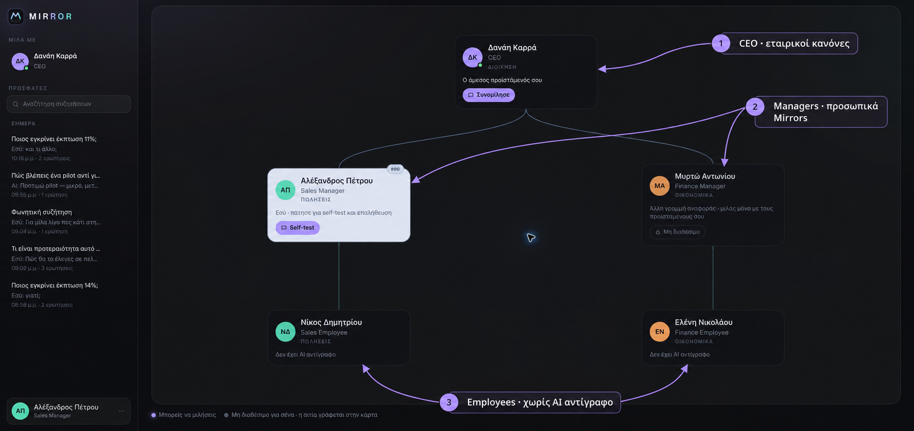
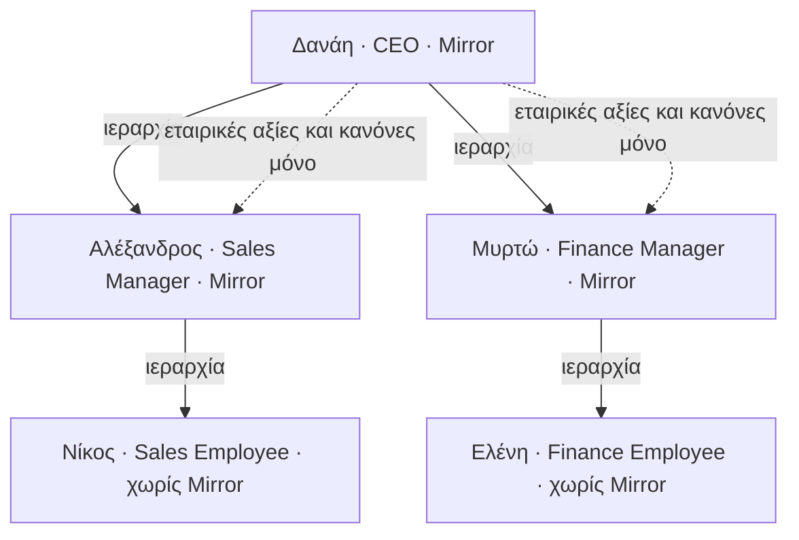
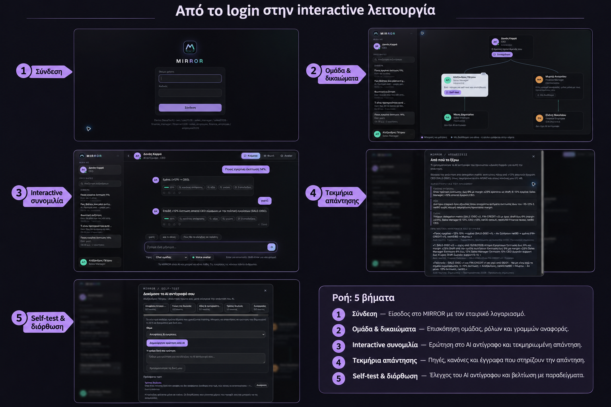
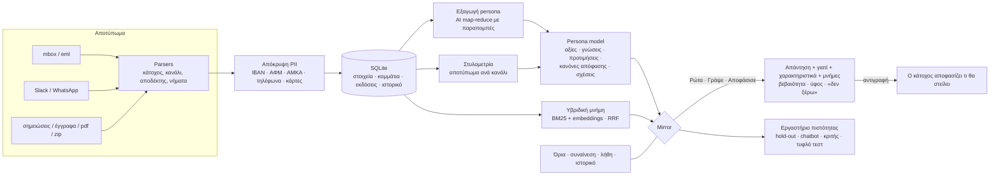

# MIRROR — ο ψηφιακός σου εαυτός

> **Netcompany Hackathon Athens 2026 · Challenge 1 — AI: Your digital self**
>
> **M.I.R.R.O.R.** = *Machine Intelligence Replicating Routine Operations & Responses* — τεχνητή νοημοσύνη που αναπαράγει καθημερινές λειτουργίες και απαντήσεις. · English version: [README.en.md](README.en.md)

> **Κατάσταση:** hackathon demo με συνθετικά δεδομένα. Δεν είναι έτοιμο για παραγωγική χρήση. Τα δεδομένα, οι λογαριασμοί, οι απαντήσεις και τα αποτελέσματα αξιολόγησης που περιγράφονται εδώ είναι μέρος του demo.



*Στιγμιότυπο της εφαρμογής. Η CEO βρίσκεται στην κορυφή, οι δύο managers έχουν δικά τους Mirrors και οι employees δεν έχουν ακόμη AI αντίγραφο.*

**Γρήγορη πλοήγηση:** [Εκκίνηση](#γρήγορη-εκκίνηση) · [Οδηγός login → interactive](#από-το-login-στην-interactive-λειτουργία) · [Κριτές και `.env`](#εκκίνηση-κριτών-με-πλήρες-env) · [Κληρονομικότητα](#η-εταιρεία-η-σύνδεση-και-η-κληρονομικότητα) · [Μάθηση](#4-self-test-το-ai-σου-μαθαίνει-από-εσένα) · [Avatar](#3-κείμενο-ήχος-και-avatar) · [Αρχιτεκτονική](#αρχιτεκτονική) · [Όρια demo και επόμενα βήματα](#όρια-demo-και-δυνατότητα-εξέλιξης) · [Εντολές και βοήθεια](#συχνές-εντολές-και-αντιμετώπιση-προβλημάτων)

Το MIRROR είναι ένα **AI Mirror που μπορείς να ελέγξεις**. Μαθαίνει από το ψηφιακό αποτύπωμα ενός ανθρώπου (emails, chats, σημειώσεις, έγγραφα) και μετά **απαντά, γράφει και αποφασίζει όπως θα το έκανε εκείνος, και εξηγεί γιατί**.

Επίτηδες **δεν** είναι ένα chatbot με «persona prompt». Το Mirror στηρίζεται σε τέσσερα μετρήσιμα κομμάτια:

| Κομμάτι | Τι είναι | Πώς φτιάχνεται |
|---|---|---|
| **Μνήμη** | Ό,τι έγραψε ή έλαβε ο άνθρωπος, με κρυμμένα τα προσωπικά στοιχεία | Υβριδική αναζήτηση: BM25 που καταλαβαίνει ελληνικές καταλήξεις, συν embeddings όταν υπάρχουν, με RRF |
| **Persona model** | Αξίες, γνώσεις, προτιμήσεις, **κανόνες απόφασης**, σχέσεις, το καθένα με τα τεκμήριά του | Εξαγωγή με AI (map-reduce) με παραπομπές σε συγκεκριμένα μηνύματα + ντετερμινιστική επεξεργασία |
| **Αποτύπωμα ύφους** | Πώς γράφει σε κάθε κανάλι (email προς τα έξω, chat ομάδας, φίλοι…) | Στυλομετρία με αριθμούς: 9 μετρήσεις, χαιρετισμοί, υπογραφές, emoji, χαρακτηριστικές φράσεις |
| **Έλεγχος κατόχου** | Όρια, συναίνεση ανά πηγή, δικαίωμα στη λήθη, ιστορικό, εκδόσεις | Λογική εφαρμογής και βάση δεδομένων, όχι prompts |

Και μετά **αποδεικνύουμε** ότι είναι πραγματικά εκείνος: το **Εργαστήριο πιστότητας** ελέγχει το Mirror σε αποφάσεις και απαντήσεις που δεν έχει δει ποτέ και το συγκρίνει με ένα απλό chatbot που «παίζει τον ρόλο».

Ολόκληρη η εφαρμογή (περιβάλλον, εξηγήσεις του Mirror, persona model) είναι **στα ελληνικά**.

---

## Γρήγορη εκκίνηση

```bash
git clone https://github.com/Agelosgalatas1/mirror-zv.git
cd mirror-zv
cp .env.example .env
# Άνοιξε το .env και συμπλήρωσε τα keys που αντιστοιχούν στις λειτουργίες που θέλεις.
docker compose up --build -d
docker compose ps
docker compose logs -f mirror
```

Άνοιξε το **http://localhost:8000**. Για να σταματήσεις την εφαρμογή: `docker compose down`. Τα δεδομένα μένουν στο Docker volume `mirror-data`. Για καθαρή εγκατάσταση που διαγράφει και τη βάση: `docker compose down -v`.

- **Για δοκιμή χωρίς εξωτερικά keys:** το demo ξεκινά και offline πάνω στα έτοιμα persona snapshots. Το περιβάλλον, η ιεραρχία και οι offline απαντήσεις είναι διαθέσιμα· οι κλήσεις LLM, ElevenLabs και Simli χρειάζονται τα αντίστοιχα keys.
- **Για πλήρες live demo:** χρειάζεται ένας πάροχος LLM (`OPENAI_API_KEY` ή `ANTHROPIC_API_KEY`), `ELEVENLABS_API_KEY` για φωνή/μεταγραφή, και `SIMLI_API_KEY` για το ανθρώπινο avatar. Προαιρετικά ορίζονται μοντέλα/voice IDs. Αναλυτικός πίνακας: [Ρυθμίσεις `.env`](#ρυθμίσεις-env-και-keys).
- **Εντελώς τοπικά με Ollama:** `docker compose --profile local-llm up --build -d`, έπειτα `docker compose exec ollama ollama pull qwen2.5:7b` και στο `.env` βάλε `LLM_PROVIDER=ollama`, `OLLAMA_BASE_URL=http://ollama:11434`. Για voice/avatar εξακολουθούν να χρειάζονται οι αντίστοιχες υπηρεσίες και keys.

Στο πρώτο ξεκίνημα φορτώνεται η **φανταστική εταιρεία NexaTech Solutions**. Με `AUTO_SEED=true`, τα δεδομένα demo εισάγονται μόνο όταν η βάση είναι κενή. Σε ενημέρωση snapshot ανανεώνονται αυτόματα μόνο τα αρχικά, μη επεξεργασμένα προφίλ snapshot· οι συνομιλίες, οι πηγές και τα προφίλ που χτίστηκαν ή διορθώθηκαν από κάτοχο διατηρούνται. **Δεν τρέχει αναπαραγωγή/εισαγωγή ανά 120 δευτερόλεπτα.**

Απαιτήσεις: Docker Engine/Desktop με Docker Compose v2 (Linux, macOS ή Windows). Το container σερβίρει API και frontend στην ίδια θύρα· η προεπιλογή είναι η `8000` (`PORT` στο `.env`).

### Εκκίνηση κριτών με πλήρες `.env`

Ο διοργανωτής θα στείλει στους κριτές με email το πλήρες `.env` με τα απαραίτητα keys. Αποθηκεύστε το στον φάκελο του project και εκκινήστε:

```bash
docker compose up --build -d
docker compose ps
```

Ανοίξτε `http://localhost:8000` και συνδεθείτε με έναν από τους [demo λογαριασμούς](#demo-λογαριασμοί-και-πρόσβαση).

### Ρυθμίσεις `.env` και keys

| Key | Χρήση |
|---|---|
| `OPENAI_API_KEY` | Απαντήσεις AI και εξαγωγή persona |
| `ELEVENLABS_API_KEY` | Φωνή και μεταγραφή |
| `SIMLI_API_KEY` | Ζωντανό human avatar |

> **Όριο avatar:** Με τους διαθέσιμους πόρους της ομάδας, υποστηρίζεται μόνο **ένα ταυτόχρονο Simli session**.

Το `.env` διανέμεται απευθείας στους κριτές με email και δεν ανεβαίνει στο GitHub.

---

## Διατήρηση δεδομένων και δημοσίευση κανόνων

- Το `AUTO_SEED=true` αρχικοποιεί μόνο κενή εγκατάσταση. Ενημέρωση snapshot ανανεώνει μόνο έτοιμο, μη επεξεργασμένο προφίλ· δεν διαγράφει συνομιλίες, πηγές, διορθωμένα ή LLM-built προφίλ.
- **Πριν από την παρουσίαση:** ως κάτοχος, άνοιξε το self-test και την ενότητα εταιρικών κανόνων. Διάβασε κάθε κανόνα και δημοσίευσε μόνο όσους θέλεις να κληρονομήσουν οι υφιστάμενοι.
- Το συνθετικό demo περιλαμβάνει τις βασικές εταιρικές πολιτικές της CEO από το DOC02. Οι κάτοχοι εγκρίνουν πρόσθετους κανόνες για δημοσίευση μέσω του Self-test. Οι προσωπικές μνήμες μένουν στον κάτοχο.
- Για σκόπιμη επαναφορά της demo βάσης, η CEO χρησιμοποιεί τη λειτουργία reset μέσα στην εφαρμογή. Πριν την επαναφορά δημιουργείται αντίγραφο ασφαλείας.

## Η εταιρεία, η σύνδεση και η κληρονομικότητα

Η demo εταιρεία είναι η **NexaTech Solutions** (φανταστική, B2B τεχνολογία και εξοπλισμός), με συνθετικά datasets από το repo ZV (`sources/`):

```text
Δανάη (CEO)
├──→ Αλέξανδρος (Sales) ──→ Νίκος (Sales Employee)
└──→ Μυρτώ (Finance) ──→ Ελένη (Finance Employee)
```

```
                       Δανάη Καρρά — CEO
                     /                    \
     Αλέξανδρος Πέτρου —              Μυρτώ Αντωνίου —
        Sales Manager                   Finance Manager
             |                                |
     Νίκος Δημητρίου —                Ελένη Νικολάου —
        Sales Employee                  Finance Employee
```



Οι συνεχείς γραμμές δείχνουν reporting lines. Τα διακεκομμένα βέλη δείχνουν κληρονόμηση μόνο για company-scope αξίες και decision rules. Πρόσβαση συνομιλίας επιτρέπεται προς τους προϊσταμένους, όχι προς τα κάτω ή στο πλάι.

- Οι δύο managers **αναφέρονται μόνο στην CEO**, και κάθε employee μόνο στον manager του.
- **Η CEO και οι managers έχουν το δικό τους AI αντίγραφο (Mirror)** και τη δική τους μνήμη. Ένας manager δεν βλέπει ποτέ τα δεδομένα του άλλου. Οι employees, όπως στο ZV, δεν έχουν ακόμα δικό τους AI.
- **Κληρονομικότητα.** Τα Mirrors Sales και Finance χρησιμοποιούν τις βασικές εταιρικές πολιτικές της CEO και όσες πρόσθετες αξίες ή κανόνες έχει δημοσιεύσει. Σε σύγκρουση με τοπικό κανόνα υπερισχύει ο εφαρμοστέος εταιρικός κανόνας της CEO.
- Πρακτικά, μόνο οι **εταιρικές αξίες και οι κανόνες απόφασης** περνούν από τους προϊσταμένους προς τα κάτω. Χαρακτηριστικά με scope `personal` μένουν στο Mirror του κατόχου. Οι κληρονομημένοι κανόνες είναι read-only στο προφίλ του manager, εμφανίζουν την προέλευσή τους και το Mirror τους βάζει πριν από τους δικούς του κανόνες ώστε να τηρεί την πολιτική της εταιρείας.
- **Πρόσβαση στο δικό σου Mirror και στους προϊσταμένους:** η CEO και οι managers μπορούν να ανοίξουν το δικό τους Mirror και να κάνουν **self-test**. Οι εργαζόμενοι συνομιλούν με το Mirror του manager τους και της CEO. Στη συνομιλία με προϊστάμενο χρησιμοποιούνται τα επιλεγμένα συνθετικά έγγραφα και δείγματα επικοινωνίας του αντίστοιχου Mirror, μαζί με τους κοινούς εταιρικούς κανόνες. Ο server εφαρμόζει τα δικαιώματα πρόσβασης.

### Demo λογαριασμοί και πρόσβαση

Οι παρακάτω λογαριασμοί είναι αποκλειστικά για το συνθετικό demo· οι κωδικοί δεν είναι εταιρικά credentials:

| Ρόλος | Όνομα χρήστη | Email | Κωδικός |
|---|---|---|---|
| CEO | `ceo` | `d.karra@nexatech.example` | `ceo2026` |
| Sales Manager | `sales_manager` | `a.petrou@nexatech.example` | `sales2026` |
| Finance Manager | `finance_manager` | `m.antoniou@nexatech.example` | `finance2026` |
| Sales Employee | `sales_employee` | `n.dimitriou@nexatech.example` | `employee2026` |
| Finance Employee | `finance_employee` | `e.nikolaou@nexatech.example` | `employee2026` |

Οι κωδικοί αποθηκεύονται ως hash (PBKDF2). Η σύνδεση κρατιέται σε cookie `HttpOnly` / `SameSite=Strict`, και κάθε αλλαγή απαιτεί επιπλέον το header `X-Mirror-Request` (προστασία CSRF). Για API clients δουλεύει και `Authorization: Bearer <token>`.

### Τα δεδομένα της εταιρείας

Τα datasets εισάγονται από τον αδελφό φάκελο `ZV/sources` με `python scripts/import_zv.py` (ή δώσε τη διαδρομή ως όρισμα) στο `backend/data/demo/<πρόσωπο>/`. Υπάρχουν 28 συνθετικές πηγές για καθένα από τα τρία Mirrors.

| Πηγή | Περιεχόμενο (ανά πρόσωπο) |
|---|---|
| `emails/*.eml` | 10 emails: κλιμακώσεις (BlueHarbor, AegeanWorks, Pineworks, Northbridge, HelioMed…), αποφάσεις, ανακοινώσεις πολιτικών |
| `chats/*.json` | Συνομιλίες Teams (CEO ↔ managers, ομάδα Sales, deal desk Sales–Finance, ομάδα Finance) |
| `notes/`, `documents/`, `meetings/`, `transcripts/` | Σημειώσεις, πολιτικές (SALE-DISC v1/v2, FIN-CREDIT v1/v2, FIN-PROC-03), memos, πρακτικά, τηλεφωνικές διαπραγματεύσεις |
| `docs/decision_log.md` | Το αρχείο αποφάσεων 2026: συνθήκες, επιλογές, τι απορρίφθηκε, αιτιολόγηση, όριο εξουσιοδότησης |
| `docs/workflow_log.md` | Βήμα-βήμα ροές εγκρίσεων στο CRM / ERP |
| `docs/drafts_and_final_texts.md` | Πρόχειρα και τελικά κείμενα μετά την επιμέλεια (πώς γράφει πραγματικά το πρόσωπο) |
| `personality_seed/*.eml` | Δύο χαρακτηριστικές αλληλεπιδράσεις για το ύφος |
| `eval/` | Τα πρωτότυπα παραδείγματα ZV της 12/11/2026 και το `holdout.json` χρησιμοποιούνται για έλεγχο. Ο φάκελος εξαιρείται από την εισαγωγή γνώσης. |

Το έτοιμο persona model κάθε προσώπου (`backend/data/snapshot/`) βγήκε από αυτά τα δεδομένα με `python -m tools.build_snapshots`, ώστε το demo να δουλεύει και χωρίς κλειδί.

## Από το login στην interactive λειτουργία



*Οπτικός οδηγός με τις πέντε βασικές οθόνες. Τα στοιχεία είναι συνθετικά και ανήκουν στο demo της NexaTech.*

### 1. Σύνδεση

Άνοιξε `http://localhost:8000` αφού ξεκινήσει το Docker και συνδέσου με ένα demo όνομα χρήστη και κωδικό από τον πίνακα [Demo λογαριασμοί και πρόσβαση](#demo-λογαριασμοί-και-πρόσβαση). Για παράδειγμα, χρησιμοποίησε `sales_manager` / `sales2026`. Τα API keys ρυθμίζονται μόνο στον server μέσω του `.env`· δεν πληκτρολογούνται στη φόρμα σύνδεσης και δεν εκτίθενται στο frontend.

### 2. Επίλεξε Mirror από την ομάδα

Η πυραμίδα δείχνει τους ανθρώπους, τους ρόλους και τις γραμμές αναφοράς. Επίλεξε κάρτα με διαθέσιμη συνομιλία και πάτησε **Συνομίλησε**. Η πρόσβαση ακολουθεί την ιεραρχία προς τα πάνω: για παράδειγμα, ο Sales Manager μιλά με το Mirror της CEO. Αν μετά τη σύνδεση ανοίξει αποθηκευμένη συνομιλία, πάτησε **Πίσω στην ομάδα** για να επιστρέψεις στην πυραμίδα.

Για να κάνεις ερωτήσεις στα δικά σου αρχεία, επίλεξε **Το δικό σου Mirror** στην πλαϊνή στήλη. Στην ίδια συνομιλία χρησιμοποιείται και η γνώση που έχεις επιβεβαιώσει από το **Self-test**.

### 3. Κάνε ερώτηση και συνέχισε τη συνομιλία

Στη συνομιλία μπορείς να πατήσεις μια προτεινόμενη ερώτηση ή να γράψεις τη δική σου στο πεδίο μηνύματος και να πατήσεις το βέλος/Enter. Για δοκιμή, ρώτησε **«Ποιος εγκρίνει έκπτωση 14%;»**. Το παράδειγμα στο στιγμιότυπο απαντά «Εμένα. (>12% → CEO)» και εμφανίζει βεβαιότητα, χαρακτηριστικά και επιλογές συνέχειας. Το Mirror απαντά με τα δεδομένα και τους κανόνες του συγκεκριμένου προσώπου· γράψε **«γιατί;»** για να ζητήσεις αιτιολόγηση.

Το αναπτυσσόμενο **Ύφος** αλλάζει το πλαίσιο σύνταξης (π.χ. chat ομάδας, προσωπικό chat ή email). Οι συζητήσεις αποθηκεύονται για τον συνδεδεμένο χρήστη, οπότε μπορείς να επιστρέψεις σε αυτές από την αριστερή στήλη. Οι επιλογές θετικής/αρνητικής ανατροφοδότησης αξιολογούν την ομοιότητα· από μόνες τους **δεν εκπαιδεύουν** το μοντέλο.

### 4. Έλεγξε από πού προήλθε η απάντηση

Σε μια απάντηση πάτησε **3 αποδείξεις** (ο αριθμός διαφέρει ανά απάντηση). Το παράθυρο δείχνει ποια χαρακτηριστικά του προσώπου και ποια αποθηκευμένα μηνύματα ή έγγραφα τη στήριξαν. Κλείσε το παράθυρο με **Εντάξει** ή το **×** για να συνεχίσεις τη συζήτηση. Έτσι μπορείς να ελέγξεις την πηγή πριν βασιστείς στην απάντηση.

### 5. Δοκίμασε φωνή ή avatar (προαιρετικά)

- **Φωνή:** επίλεξε τη λειτουργία Φωνή για να ακουστεί η απάντηση. Για ερώτηση από μικρόφωνο, το MIRROR μεταγράφει πρώτα το κείμενο ώστε να το ελέγξεις πριν σταλεί.
- **Avatar:** επίλεξε Avatar για απάντηση με ζωντανό πρόσωπο και φωνή. Απαιτούνται τα `ELEVENLABS_API_KEY` και `SIMLI_API_KEY` στο `.env`.
- **Voice avatar:** το checkbox ανοίγει hands-free κύκλο ακρόασης και απάντησης· ο browser θα ζητήσει πρόσβαση στο μικρόφωνο όταν ενεργοποιήσεις τη λειτουργία.

Η τρέχουσα συνδρομή Simli υποστηρίζει **ένα ενεργό human-avatar session κάθε φορά**. Αν είναι απασχολημένο, η εφαρμογή δοκιμάζει μία φορά ακόμη και μετά συνεχίζει με ήχο χωρίς εικόνα. Οι εξωτερικές κλήσεις χρησιμοποιούν τα keys του διοργανωτή και υπόκεινται στα όρια και τις χρεώσεις των λογαριασμών του.

### 6. Έλεγξε και διόρθωσε το δικό σου Mirror

Από τη δική σου κάρτα στην πυραμίδα άνοιξε το **Self-test**. Διάλεξε θέμα, γράψε ερώτηση ή ζήτησε από το AI να δημιουργήσει μία. **Απάντησε πρώτα εσύ**, μετά σύγκρινε την απάντηση του Mirror και σημείωσε αν είναι σωστή. Αν χρειάζεται, πρόσθεσε τη σωστή διόρθωση: αποθηκεύεται ως γνώση επαληθευμένη από τον κάτοχο και μπορείς να την αναιρέσεις από το ίδιο παράθυρο.

### Σημείωση για το demo

Όλα τα πρόσωπα, έγγραφα, συνομιλίες και οι λογαριασμοί στις εικόνες είναι φανταστικά. Το MIRROR είναι demo υποστήριξης και σύνταξης, όχι αυτόνομος υπεύθυνος αποφάσεων: έλεγχε τις πηγές και κράτα τις τελικές εγκρίσεις σε άνθρωπο.

---

## Λειτουργίες

### 1. Η ομάδα (αρχική)
- **Ζωντανή πυραμίδα της εταιρείας** με καμπύλες γραμμές αναφοράς και φωτεινά σήματα που ανεβαίνουν προς τα πάνω. Σε στενές οθόνες γίνεται δέντρο.
- Κάθε κάρτα λέει **αν και γιατί** μπορείς να μιλήσεις με εκείνο το AI: «Ο άμεσος προϊστάμενός σου», «Αναφέρεται σε σένα · η συνομιλία γίνεται μόνο προς τα πάνω», «Άλλη γραμμή αναφοράς». Η αιτία έρχεται από τον server (`/api/hierarchy`).
- Η δική σου κάρτα ανοίγει το **self-test** του AI σου.

### 2. Συνομιλίες
- **Chat σαν ChatGPT:** αποθηκευμένες συζητήσεις ανά Mirror, ομαδοποιημένες (Σήμερα / Χθες / 7 ημέρες / Παλαιότερα), **αναζήτηση**, μετονομασία, διαγραφή, προεπισκόπηση της τελευταίας ερώτησης. Το ιστορικό κρατιέται στον server, οπότε τα follow-ups («γιατί;», «και τι άλλο;») δουλεύουν και μετά από ανανέωση. Κάθε χρήστης βλέπει μόνο τις δικές του συζητήσεις.
- **Υποδοχή** με έτοιμες ερωτήσεις ανά πρόσωπο και ρόλο, απαντήσεις που «γράφονται», αντιγραφή, **👍 / 👎 «μοιάζει / δεν μοιάζει με το πρόσωπο»**.
- Κάθε απάντηση είναι κάρτα με **βεβαιότητα** και **chips** («κανόνας από Δανάη», «γνώση», «3 αποδείξεις»). Με ένα κλικ ανοίγει το **«Από πού το ξέρω»**, με τα χαρακτηριστικά και τα πραγματικά μηνύματα και έγγραφα.
- **Άκουσε** οποιαδήποτε απάντηση (φωνή του προσώπου ή του browser), **Ξανά** για νέα απάντηση, **επεξεργασία** μιας ερώτησης σου, έτοιμες συνέχειες **«γιατί;» / «και τι άλλο;»**, επιλογή **ύφους** (chat ομάδας, email σε πελάτη…).
- Συντομεύσεις: `/` για γράψιμο, `Enter` αποστολή, `Shift+Enter` νέα γραμμή, `↑` η τελευταία ερώτηση, `Esc` σταματά τον ήχο. Κουμπί «στα νεότερα» όταν διαβάζεις παλιότερα μηνύματα.
- Το AI απαντά **σε πρώτο πρόσωπο, μόνο από τα δεδομένα** του προσώπου: λέει «δεν ξέρω» σε ό,τι δεν έχει γραφτεί ποτέ, σέβεται όρια (υγεία, οικονομικά, πολιτική/θρησκεία, σχέσεις) και, όταν μια απόφαση ξεπερνά τα όριά του, λέει σε ποιον την κλιμακώνει.

### 3. Κείμενο, ήχος και avatar
- **Κείμενο με υπαγόρευση:** πάτησε 🎤, μίλησε, πάτησε ξανά για διακοπή, έλεγξε τη μεταγραφή και στείλε. Με `ELEVENLABS_API_KEY` χρησιμοποιείται η μεταγραφή Scribe, αλλά η απάντηση παραμένει γραπτή· δεν καλούνται TTS ή Simli. Το ήδη γραμμένο κείμενο διατηρείται. Το πρότυπο `.env.example` επιλέγει `ELEVENLABS_STT_MODEL=scribe_v3`.
- **Ήχος:** με `ELEVENLABS_API_KEY` κάθε πρόσωπο απαντά με τη δική του φωνή ElevenLabs (Sophia για τη Δανάη, Eric για τον Αλέξανδρο, Zenia για τη Μυρτώ) και το 🎤 μεταγράφει με ElevenLabs Scribe. Η μεταγραφή εμφανίζεται πρώτα για έλεγχο και διόρθωση, και μετά στέλνεται.
- **Avatar:** με `SIMLI_API_KEY`, ζωντανό πρόσωπο Simli (Kate, Hank, Zahra) λέει την απάντηση με κίνηση χειλιών, με τον ίδιο ήχο. Ο server δίνει στον browser μόνο βραχύβιο session token για **μία ελεγμένη απάντηση**, με τοπικό ημερήσιο όριο (`SIMLI_DAILY_SECONDS`). Η τρέχουσα Simli συνδρομή υποστηρίζει **ένα ενεργό human-avatar session κάθε φορά**. Αν το Simli αναφέρει απασχολημένη συνεδρία, το UI περιμένει μία φορά για την προηγούμενη σύντομη απάντηση· αν δεν ξεκινήσει, η απάντηση συνεχίζει μόνο με ήχο. Το avatar δεν χρησιμοποιεί ανοιχτό μικρόφωνο για να στέλνει live βίντεο/φωνή.
- **Voice avatar:** φωνητική συνομιλία χωρίς χέρια. Ένα «orb» ακούει, καταλαβαίνει την παύση, απαντά με φωνή και ξανακούει, μέχρι να πατήσεις παύση.
- Ο ήχος μένει στον server και λήγει σε 24 ώρες. Στο ElevenLabs στέλνεται μόνο το τελικό κείμενο της απάντησης.

### 4. Self-test: το AI σου μαθαίνει από εσένα
- Διάλεξε θέμα (Αποφάσεις & εγκρίσεις, Γνώση της δουλειάς, Αξίες, Τρόπος δουλειάς, Συνεργασίες) ή γράψε δική σου ερώτηση.
- **Απαντάς πρώτα εσύ**, μετά βλέπεις δίπλα-δίπλα την απάντηση του AI και τη βαθμολογείς σωστή ή λάθος.
- Αν η απάντηση είναι λάθος και γράψεις διόρθωση, αυτή γίνεται **επιβεβαιωμένη γνώση** στο προφίλ σου και μπορεί να χρησιμοποιηθεί αμέσως σε επόμενες απαντήσεις. Η καταχώριση μπορεί να αναιρεθεί με ένα κλικ.
- **Μαθαίνει από κάθε συνομιλία.** Κάθε 👍/👎 σε μια απάντηση ενισχύει ή αποδυναμώνει τα χαρακτηριστικά του προσώπου που χρησιμοποίησε εκείνη η απάντηση (μία ψήφος ανά χρήστη και απάντηση, μέγιστη μετατόπιση ±0,25 από ό,τι λένε τα τεκμήρια). Ισχύει αμέσως στις επόμενες απαντήσεις, με AI και offline.
- **Ερωτήσεις που δεν ήξερε:** όταν κάποιος της ομάδας ρωτά κάτι που το Mirror δεν ξέρει, η ερώτηση εμφανίζεται στο self-test του κατόχου («Τι έμαθε το Mirror σου από τις συνομιλίες»). Με «Απάντησέ το», η απάντηση του κατόχου γίνεται επιβεβαιωμένη γνώση και η ερώτηση φεύγει από τη λίστα· με αναίρεση επιστρέφει.
- Τα λόγια των άλλων **δεν γίνονται ποτέ** χαρακτηριστικά ή πηγές του προσώπου: μόνο ο κάτοχος εγκρίνει νέα γνώση. Το project δεν κάνει fine-tuning βαρών LLM. Νέα αρχεία χρειάζονται εισαγωγή/συγκατάθεση και, για AI εξαγωγή νέου persona, ρητό rebuild προφίλ.
- Τρεις συνεχόμενες σωστές απαντήσεις → το θέμα σημειώνεται **επαληθευμένο**.

### Ενημέρωση δεδομένων και μάθηση

| Ενέργεια | Τι συμβαίνει τώρα |
|---|---|
| Εκκίνηση με άδεια βάση | `AUTO_SEED=true` εισάγει τα συνθετικά δεδομένα NexaTech και φορτώνει τα έτοιμα snapshots. |
| Αλλαγή demo πακέτου κώδικα | Τα υπάρχοντα δεδομένα διατηρούνται. Η επαναφορά γίνεται μόνο με ρητή ενέργεια διαχειριστή. |
| Διόρθωση από τον κάτοχο στο self-test | Γράφεται ως owner-verified γνώση στο προφίλ και είναι διαθέσιμη για επόμενες απαντήσεις· υπάρχει undo. |
| 👍/👎 στην απάντηση συνομιλίας | Αλλάζει αμέσως τη βαρύτητα των χαρακτηριστικών που χρησιμοποίησε η απάντηση (`app/learning.py`). Δεν αλλάζει τα βάρη του LLM. |
| Ερώτηση που το Mirror δεν ήξερε | Μπαίνει στη λίστα του self-test του κατόχου· η απάντησή του γίνεται επιβεβαιωμένη γνώση. |
| Νέα πηγή δεδομένων | Εισάγεται με τη ροή πηγών, μετά τη συγκατάθεση γίνεται απόκρυψη PII/τεμαχισμός/ευρετηρίαση. Το AI rebuild είναι ρητή ενέργεια, όχι αυτόματη εκπαίδευση. |
| Αυτόματη αναπαραγωγή κάθε 120 δευτερόλεπτα | **Δεν υλοποιείται στο παρόν demo.** Τα timers και heartbeats του frontend εξυπηρετούν UI/audio sessions, όχι επανεισαγωγή δεδομένων ή εκπαίδευση του Mirror. |


### 5. Persona model (στο παρασκήνιο)
- **Αξίες, γνώσεις, προτιμήσεις, κανόνες απόφασης, σχέσεις, φωνή, όσα δεν ξέρει**, το καθένα με τα μηνύματα που το αποδεικνύουν. Χαρακτηριστικό χωρίς τεκμήρια δεν κρατιέται.
- Οι **κανόνες απόφασης** είναι δομημένοι: πότε ισχύουν, τι προτιμά (+), τι αποφεύγει (−), αριθμητικά όρια (π.χ. «6–12% εγκρίνω εγώ, >12% η CEO») και **scope** (εταιρικός κανόνας που κληρονομείται ή προσωπικός).
- **Αποτύπωμα ύφους ανά κανάλι**, εκδόσεις, σύγκριση, διορθώσεις από τον κάτοχο (`/api/profile*`).

### 6. Μέτρηση πιστότητας
| Μέτρηση | Πώς |
|---|---|
| **Πιστότητα αποφάσεων** | Πρόβλεψη της πραγματικής επιλογής σε κρυφά διλήμματα (4 ανά πρόσωπο), έναντι του chatbot |
| **Ομοιότητα απάντησης** | Στυλομετρική απόσταση ανάμεσα στο draft και την πραγματική απάντηση |
| **Ταίριασμα ύφους** | Ομοιότητα με το αποτύπωμα ύφους του καναλιού |
| **Κριτής AI** | Τυφλή σύγκριση (τυχαία σειρά Α/Β): ποιο είναι πιο κοντά στην πραγματική απάντηση |
| **Γνώσεις** | Ερωτήσεις γεγονότων από τη μνήμη |
| **Έντιμο «δεν ξέρω»** | Σε ερωτήσεις που δεν έχουν απαντηθεί ποτέ πρέπει να πει «δεν ξέρω»· ένα Mirror που επινοεί απόψεις είναι κίνδυνος πλαστοπροσωπίας |
| **Τυφλό τεστ με ανθρώπους** | Ο κόσμος μαντεύει ποια απάντηση είναι η αληθινή· μετριέται πόσο συχνά ξεγελιέται |

### 7. Ιδιωτικότητα (λειτουργεί αυτόματα)
- **Το Mirror δεν στέλνει ποτέ τίποτα**: γράφει drafts, και ο κάτοχος αποφασίζει τι θα αντιγράψει και θα στείλει.
- **Όρια**: για υγεία, προσωπικά οικονομικά, πολιτική/θρησκεία και σχέσεις το Mirror απαντά «Αυτό προτιμώ να το απαντήσω εγώ».
- **Συναίνεση και διαγραφή ανά πηγή** στην Αρχική (Τα δεδομένα μου).
- **Σήμανση** στα drafts («Γράφτηκε από το MIRROR»), κατά της πλαστοπροσωπίας.
- **Ιστορικό ενεργειών** (τα κλειδιά API δεν καταγράφονται ποτέ).
- Το κείμενο που στέλνεται σε LLM περνά πρώτα από ανιχνευτές απόκρυψης PII· αυτό δεν αποτελεί εγγύηση πλήρους ανωνυμοποίησης. Τα αρχικά αρχεία δεν διατηρούνται μετά την ανάγνωση. Η βάση είναι τοπική SQLite σε Docker volume.
- Με Ollama, τα αιτήματα LLM μπορούν να εκτελούνται τοπικά. Αν ενεργοποιήσεις ElevenLabs ή Simli, τα αντίστοιχα δεδομένα/κείμενα αποστέλλονται στους παρόχους τους.

---

## Αρχιτεκτονική



**Backend** (`backend/app`, Python 3.12, FastAPI)

| Αρχείο | Ρόλος |
|---|---|
| `ingest/parsers.py` | Αναγνώριση μορφής και μετατροπή σε ενιαία στοιχεία |
| `ingest/pipeline.py` | Απόκρυψη → κομμάτια → embeddings → αποθήκευση → ευρετήριο· συναίνεση και διαγραφή |
| `privacy.py` | Ανιχνευτές PII με ελέγχους ψηφίων· πολύγλωσσα όρια |
| `retrieval.py` | BM25 (χωρίς τόνους, προθέματα για ελληνικά) + embeddings, σύντηξη RRF |
| `stylometry.py` | Μετρήσεις ύφους, προφίλ καναλιών, βαθμός ομοιότητας, κανόνες ύφους σε απλά ελληνικά |
| `profile.py` | Εξαγωγή persona με AI, offline εναλλακτική, έτοιμο προφίλ, εκδόσεις, σύγκριση, διορθώσεις, γράφος γνώσης |
| `twin.py` | Ρώτα / Γράψε / Αποφάσισε (με AI και offline), αυτοδιόρθωση, βαθμονόμηση, σύγκριση με chatbot |
| `evaluation.py` | Μετρήσεις πιστότητας, κριτής AI, τυφλό τεστ, αυτόματο hold-out για δικά σου δεδομένα |
| `llm.py` | Πάροχοι: Anthropic (`claude-opus-5-5`, με server-side fallback), OpenAI, Ollama, offline. Μόνο JSON απαντήσεις, με επανάληψη αν χρειαστεί διόρθωση |
| `prompts.py` | Όλα τα prompts σε ένα σημείο |
| `auth.py` | Συνδέσεις (cookie ή bearer), προστασία CSRF, κανόνες πρόσβασης «μόνο προς τα πάνω» |
| `mirror_api.py` | Το API του web app: ομάδα, συζητήσεις, φωνητικές απαντήσεις, Simli, self-test |
| `voice.py` | ElevenLabs (φωνή ανά πρόσωπο, Scribe) και Simli (βραχύβια tokens, ημερήσιο όριο) |
| `main.py` | REST API, εργασίες στο παρασκήνιο, σερβίρισμα του frontend |

**Frontend** (`frontend/`, το web app της ομάδας από το ZV, απλό HTML/CSS/JavaScript χωρίς framework και χωρίς build): σύνδεση, «Η ομάδα» (πυραμίδα), συζητήσεις με ιστορικό και αναζήτηση, Κείμενο / Ήχος / Avatar, Voice avatar και self-test, όλα στα ελληνικά. Όλα τα δεδομένα του server μπαίνουν στη σελίδα ως κείμενο (ποτέ ως HTML), προσαρμόζεται σε κινητά, λειτουργεί από το πληκτρολόγιο, έχει ARIA ρόλους, σκοτεινό/φωτεινό θέμα και σέβεται το `prefers-reduced-motion`. Το Simli client είναι τοπικό bundle (`vendor/simli.bundle.js`, MIT, άδειες στο `vendor/SIMLI-LICENSES.txt`).

### Βασικές επιλογές
- **Δομημένες απαντήσεις παντού.** Το Mirror επιστρέφει JSON (απάντηση, γιατί, χαρακτηριστικά, μνήμες, βεβαιότητα, αβεβαιότητα), ώστε κάθε ισχυρισμός να ελέγχεται και το UI να δείχνει το *γιατί*.
- **Το ύφος μετριέται με αριθμούς, όχι από το AI.** Η στυλομετρία είναι ντετερμινιστική, άρα δίκαιο μέτρο και ταυτόχρονα δικλίδα.
- **Ομαλή υποβάθμιση για LLM κείμενο.** Anthropic → OpenAI → Ollama → offline. Το app ξεκινά και χωρίς LLM key· φωνή και avatar χρειάζονται ElevenLabs/Simli keys.
- **Πρώτα τα τεκμήρια.** Ένα χαρακτηριστικό χωρίς τεκμήρια σβήνεται, και έτσι το δικαίωμα στη λήθη είναι πραγματικό.
- **Σκόπιμα χωρίς fine-tuning.** Η μνήμη (RAG) μαζί με την εξαγωγή προφίλ κρατά το Mirror ενημερωμένο (νέα δεδομένα → ξαναχτίσιμο → σύγκριση), ελέγξιμο και διαγράψιμο· τα βάρη ενός fine-tuned μοντέλου δεν μπορούν να «ξεχάσουν».

---

## Όρια demo και δυνατότητα εξέλιξης

Το repository δείχνει την ιδέα σε μία φανταστική εταιρεία, με πέντε συνθετικά πρόσωπα, τρία Mirrors, τοπική SQLite και ένα Docker service. Το σύνολο αξιολόγησης είναι μικρό και συνθετικό. Δεν αποτελεί ολοκληρωμένο HR προϊόν, enterprise σύστημα ταυτοτήτων, multi-tenant υπηρεσία ή πιστοποιημένο έλεγχο ασφάλειας.

Με την κατάλληλη ομάδα, τον χρόνο και τους πόρους μπορεί να εξελιχθεί σε οργανόγραμμα μεγάλης εταιρείας, με Mirrors για πολλά τμήματα και επίπεδα. Αυτό θα απαιτούσε ξεχωριστή υλοποίηση για HRIS/identity integrations, SSO και MFA, διαχωρισμό tenants, λεπτομερή δικαιώματα ανά ρόλο και δεδομένο, βάση παραγωγής και ουρά εργασιών, κλιμακούμενη αναζήτηση, monitoring, backups, διατήρηση audit, όρια κόστους/ρυθμού, απόκριση σε περιστατικά και νομικό/privacy review. Αυτά είναι επόμενες ανάγκες· δεν είναι λειτουργίες που υπόσχεται το παρόν demo.

## Συχνές εντολές και αντιμετώπιση προβλημάτων

| Ανάγκη ή πρόβλημα | Εντολή / έλεγχος |
|---|---|
| Εκκίνηση ή αναδημιουργία του container | `docker compose up --build -d` |
| Κατάσταση και health check | `docker compose ps` |
| Live logs | `docker compose logs -f mirror` (σταμάτημα προβολής με `Ctrl+C`) |
| Εφαρμογή αλλαγών στα `.env` values | `docker compose up -d --build --force-recreate mirror` |
| Σταμάτημα χωρίς διαγραφή δεδομένων | `docker compose down` |
| Καθαρή βάση και demo δεδομένα | `docker compose down -v`· διαγράφει το volume, άρα και το ιστορικό/κατάσταση της εγκατάστασης |
| Το `localhost:8000` δεν ανοίγει | Έλεγξε πρώτα `docker compose ps` και `docker compose logs -f mirror`. Αν η `8000` χρησιμοποιείται, βάλε `PORT=8080` στο `.env`, αναδημιούργησε το service και άνοιξε `http://localhost:8080`. |
| Δεν δουλεύει live AI | Έλεγξε ότι υπάρχει τουλάχιστον ένα LLM key στο `.env` και αναδημιούργησε το container με την εντολή παραπάνω. |
| Δεν ακούγεται φωνή ή avatar | Έλεγξε `ELEVENLABS_API_KEY` / `SIMLI_API_KEY` και τα όρια του παρόχου. Το πλάνο avatar επιτρέπει ένα ενεργό session· η φωνή παραμένει η εφεδρεία. |
| Χρειάζεται επαναφορά της demo βάσης | Χρησιμοποίησε τη ρητή λειτουργία reset ως CEO· η απλή επανεκκίνηση διατηρεί τα δεδομένα. Κάθε μηχάνημα έχει το δικό του `mirror-data` volume. |

Το `http://localhost:8000` είναι η τοπική διεύθυνση κάθε κριτή· το Docker Compose δεν δημιουργεί από μόνο του δημόσιο domain, tunnel ή TLS. Η δημοσίευση εξαρτάται από host, firewall/router και δικτυακές ρυθμίσεις. Για κοινό hosted demo χρειάζεται deployment σε προσβάσιμο host, ασφαλής πρόσβαση και καταχώριση των secrets εκεί.

## Υπεύθυνη χρήση AI
- Μόνο φανταστικά δεδομένα· κανένα πραγματικό προσωπικό δεδομένο τρίτων.
- Το Mirror είναι εργαλείο σύνταξης και υποστήριξης αποφάσεων για τον **κάτοχό** του. Δεν ενεργεί ποτέ μόνο του, δηλώνει ότι είναι Mirror, λέει «δεν ξέρω» σε άγνωστα ή ευαίσθητα θέματα, και κάθε ενέργεια καταγράφεται.
- Αρχές GDPR: ελαχιστοποίηση (απόκρυψη, όχι διατήρηση αρχικών αρχείων), περιορισμός σκοπού (Mirror μόνο για τον κάτοχο), συναίνεση ανά πηγή, διαγραφή (σβήνεις πηγή → σβήνονται χαρακτηριστικά), διαφάνεια (τεκμήρια και «γιατί» σε κάθε απάντηση).
