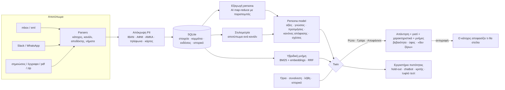

# MIRROR — ο ψηφιακός σου εαυτός

> **Netcompany Hackathon Athens 2026 · Challenge 1 — AI: Your digital self**
>
> *MIRROR*: ο καθρέφτης σου. Ένα twin που δείχνει πώς σκέφτεσαι, με αποδείξεις. · English version: [README.en.md](README.en.md)

Το MIRROR είναι ένα **ψηφιακό δίδυμο (digital twin) που μπορείς να ελέγξεις**. Μαθαίνει από το ψηφιακό αποτύπωμα ενός ανθρώπου (emails, chats, σημειώσεις, έγγραφα) και μετά **απαντά, γράφει και αποφασίζει όπως θα το έκανε εκείνος, και εξηγεί γιατί**.

Επίτηδες **δεν** είναι ένα chatbot με «persona prompt». Το twin στηρίζεται σε τέσσερα μετρήσιμα κομμάτια:

| Κομμάτι | Τι είναι | Πώς φτιάχνεται |
|---|---|---|
| **Μνήμη** | Ό,τι έγραψε ή έλαβε ο άνθρωπος, με κρυμμένα τα προσωπικά στοιχεία | Υβριδική αναζήτηση: BM25 που καταλαβαίνει ελληνικές καταλήξεις, συν embeddings όταν υπάρχουν, με RRF |
| **Persona model** | Αξίες, γνώσεις, προτιμήσεις, **κανόνες απόφασης**, σχέσεις, το καθένα με τα τεκμήριά του | Εξαγωγή με AI (map-reduce) με παραπομπές σε συγκεκριμένα μηνύματα + ντετερμινιστική επεξεργασία |
| **Αποτύπωμα ύφους** | Πώς γράφει σε κάθε κανάλι (email προς τα έξω, chat ομάδας, φίλοι…) | Στυλομετρία με αριθμούς: 9 μετρήσεις, χαιρετισμοί, υπογραφές, emoji, χαρακτηριστικές φράσεις |
| **Έλεγχος κατόχου** | Όρια, συναίνεση ανά πηγή, δικαίωμα στη λήθη, ιστορικό, εκδόσεις | Λογική εφαρμογής και βάση δεδομένων, όχι prompts |

Και μετά **αποδεικνύουμε** ότι είναι πραγματικά εκείνος: το **Εργαστήριο πιστότητας** ελέγχει το twin σε αποφάσεις και απαντήσεις που δεν έχει δει ποτέ και το συγκρίνει με ένα απλό chatbot που «παίζει τον ρόλο».

Ολόκληρη η εφαρμογή (περιβάλλον, εξηγήσεις του twin, persona model) είναι **στα ελληνικά**.

---

## Γρήγορη εκκίνηση

```bash
git clone <αυτό το repo> && cd mirror
cp .env.example .env          # προαιρετικά: βάλε ANTHROPIC_API_KEY ή OPENAI_API_KEY
docker compose up --build
```

Άνοιξε το **http://localhost:8000**. Αυτό ήταν.

- **Χωρίς κλειδί δουλεύει κανονικά.** Χωρίς κλειδί AI, το MIRROR τρέχει **offline**, πάνω σε ένα έτοιμο persona model. Περιβάλλον, προφίλ, αποφάσεις, απαντήσεις από πραγματικά μηνύματα, αξιολόγηση, ιδιωτικότητα και έλεγχος δουλεύουν όλα, οπότε το container δεν αποτυγχάνει ποτέ επειδή λείπει κλειδί.
- **Με κλειδί** (`ANTHROPIC_API_KEY` → Claude `claude-opus-5-5`, ή `OPENAI_API_KEY` → `gpt-5-mini`) έχεις απαντήσεις γραμμένες ειδικά για κάθε μήνυμα, βρόχο αυτοδιόρθωσης, ζωντανή εξαγωγή προφίλ («Ξαναχτίσε με AI»), κριτή AI στην αξιολόγηση και embeddings (OpenAI).
- Το κλειδί μπαίνει και **μέσα από την εφαρμογή** (κουμπί «Offline · Σύνδεση AI» κάτω αριστερά). Μένει μόνο στη μνήμη.
- **Εντελώς τοπικά:** `docker compose --profile local-llm up --build`, μετά `docker compose exec ollama ollama pull qwen2.5:7b`, και στο `.env` βάλε `LLM_PROVIDER=ollama`, `OLLAMA_BASE_URL=http://ollama:11434`.

Στο πρώτο ξεκίνημα φορτώνεται η **φανταστική εταιρεία NexaTech Solutions** (δες παρακάτω), ώστε το demo να δουλεύει αμέσως. Τα δεδομένα μένουν στο Docker volume `mirror-data` και ξαναφορτώνονται αυτόματα όταν αλλάξουν τα demo αρχεία. Για να σβήσεις τα πάντα: `docker compose down -v`.

Απαιτήσεις: Docker με Compose v2 (Linux, macOS ή Windows). Το image βασίζεται στο `python:3.12-slim-bookworm` (το frontend είναι απλό HTML/CSS/JS, χωρίς build) και τρέχει σε amd64 και arm64.

---

## Η εταιρεία, η σύνδεση και η κληρονομικότητα

Η demo εταιρεία είναι η **NexaTech Solutions** (φανταστική, B2B τεχνολογία και εξοπλισμός), με τα συνθετικά datasets της ομάδας μας (repo ZV, φάκελος `sources/`). Πυραμίδα διοίκησης τριών ατόμων:

```
                 Δανάη Καρρά — CEO
               /                    \
  Αλέξανδρος Πέτρου —          Μυρτώ Αντωνίου —
     Sales Manager               Finance Manager
```

- Οι δύο managers **αναφέρονται μόνο στην CEO**, όχι ο ένας στον άλλον.
- **Κάθε πρόσωπο έχει το δικό του AI αντίγραφο (Mirror)** και τη δική του μνήμη. Ένας manager δεν βλέπει ποτέ τα δεδομένα του άλλου.
- **Κληρονομικότητα:** το Mirror κάθε manager κληρονομεί τις αξίες και τους κανόνες της εταιρείας από την CEO (π.χ. «όχι αποκλειστικότητες», «>12% έκπτωση και net90 μόνο από την CEO», «η τελική προσφορά φεύγει πάντα από άνθρωπο»), μαζί με τους δικούς του. Όταν συγκρούονται, **υπερισχύει ο κανόνας της CEO** και το AI λέει από πού ήρθε. Οι προσωπικοί κανόνες της CEO δεν κληρονομούνται.
- **Πρόσβαση μόνο προς τα πάνω:** ο manager μιλά με το Mirror της CEO («τι θα αποφάσιζε η Δανάη;»), όχι με του άλλου manager. Η CEO βρίσκεται στην κορυφή: δεν έχει προϊσταμένους, οπότε κάνει **self-test** στο δικό της AI. Οι κανόνες ελέγχονται στον server, όχι στον browser.

**Demo λογαριασμοί** (όνομα χρήστη ή email, και κωδικός):

| Ρόλος | Όνομα χρήστη | Email | Κωδικός |
|---|---|---|---|
| CEO | `ceo` | `d.karra@nexatech.example` | `ceo2026` |
| Sales Manager | `sales_manager` | `a.petrou@nexatech.example` | `sales2026` |
| Finance Manager | `finance_manager` | `m.antoniou@nexatech.example` | `finance2026` |

Οι κωδικοί αποθηκεύονται ως hash (PBKDF2). Η σύνδεση κρατιέται σε cookie `HttpOnly` / `SameSite=Strict`, και κάθε αλλαγή απαιτεί επιπλέον το header `X-Mirror-Request` (προστασία CSRF). Για API clients δουλεύει και `Authorization: Bearer <token>`.

### Τα δεδομένα της εταιρείας

Τα datasets εισάγονται με `python scripts/import_zv.py <ZV>/sources` στο `backend/data/demo/<πρόσωπο>/`, όλα **100% συνθετικά**:

| Πηγή | Περιεχόμενο (ανά πρόσωπο) |
|---|---|
| `emails/*.eml` | 10 emails: κλιμακώσεις (BlueHarbor, AegeanWorks, Pineworks, Northbridge, HelioMed…), αποφάσεις, ανακοινώσεις πολιτικών |
| `chats/*.json` | Συνομιλίες Teams (CEO ↔ managers, ομάδα Sales, deal desk Sales–Finance, ομάδα Finance) |
| `notes/`, `documents/`, `meetings/`, `transcripts/` | Σημειώσεις, πολιτικές (SALE-DISC v1/v2, FIN-CREDIT v1/v2, FIN-PROC-03), memos, πρακτικά, τηλεφωνικές διαπραγματεύσεις |
| `docs/decision_log.md` | Το αρχείο αποφάσεων 2026: συνθήκες, επιλογές, τι απορρίφθηκε, αιτιολόγηση, όριο εξουσιοδότησης |
| `docs/workflow_log.md` | Βήμα-βήμα ροές εγκρίσεων στο CRM / ERP |
| `docs/drafts_and_final_texts.md` | Πρόχειρα και τελικά κείμενα μετά την επιμέλεια (πώς γράφει πραγματικά το πρόσωπο) |
| `personality_seed/*.eml` | Δύο χαρακτηριστικές αλληλεπιδράσεις για το ύφος |
| `eval/holdout.json` | **Κρυφό, δεν εισάγεται ποτέ**: τα παραδείγματα της 12/11/2026 (4 αποφάσεις, 3 απαντήσεις), 4 ερωτήσεις γνώσης, 3 ερωτήσεις όπου πρέπει να πει «δεν ξέρω» |

Το έτοιμο persona model κάθε προσώπου (`backend/data/snapshot/`) βγήκε από αυτά τα δεδομένα με `python -m tools.build_snapshots`, ώστε το demo να δουλεύει και χωρίς κλειδί.

---

## Λειτουργίες

### 1. Η ομάδα (αρχική)
- **Ζωντανή πυραμίδα της εταιρείας** με καμπύλες γραμμές αναφοράς και φωτεινά σήματα που ανεβαίνουν προς τα πάνω. Σε στενές οθόνες γίνεται δέντρο.
- Κάθε κάρτα λέει **αν και γιατί** μπορείς να μιλήσεις με εκείνο το AI: «Ο άμεσος προϊστάμενός σου», «Αναφέρεται σε σένα · η συνομιλία γίνεται μόνο προς τα πάνω», «Άλλη γραμμή αναφοράς». Η αιτία έρχεται από τον server (`/api/hierarchy`).
- Η δική σου κάρτα ανοίγει το **self-test** του AI σου.

### 2. Συνομιλίες
- **Chat σαν ChatGPT:** αποθηκευμένες συζητήσεις ανά Mirror, ομαδοποιημένες (Σήμερα / Χθες / 7 ημέρες / Παλαιότερα), **αναζήτηση**, μετονομασία, διαγραφή, προεπισκόπηση της τελευταίας ερώτησης. Το ιστορικό κρατιέται στον server, οπότε τα follow-ups («γιατί;», «και τι άλλο;») δουλεύουν και μετά από ανανέωση. Κάθε χρήστης βλέπει μόνο τις δικές του συζητήσεις.
- **Υποδοχή** με έτοιμες ερωτήσεις ανά πρόσωπο και ρόλο, απαντήσεις που «γράφονται», αντιγραφή, **👍 / 👎 «μοιάζει / δεν μοιάζει με το πρόσωπο»**.
- Το AI απαντά **σε πρώτο πρόσωπο, μόνο από τα δεδομένα** του προσώπου: λέει «δεν ξέρω» σε ό,τι δεν έχει γραφτεί ποτέ, σέβεται όρια (υγεία, οικονομικά, πολιτική/θρησκεία, σχέσεις) και, όταν μια απόφαση ξεπερνά τα όριά του, λέει σε ποιον την κλιμακώνει.

### 3. Κείμενο · Ήχος · Avatar · Voice avatar
- **Ήχος:** με `ELEVENLABS_API_KEY` κάθε πρόσωπο απαντά με τη δική του φωνή ElevenLabs (Sophia για τη Δανάη, Eric για τον Αλέξανδρο, Zenia για τη Μυρτώ) και το 🎤 μεταγράφει με ElevenLabs Scribe. Η μεταγραφή εμφανίζεται πρώτα για έλεγχο και διόρθωση, και μετά στέλνεται.
- **Avatar:** με `SIMLI_API_KEY`, ζωντανό πρόσωπο Simli (Kate, Hank, Zahra) λέει την απάντηση με κίνηση χειλιών, με τον ίδιο ήχο. Ο server δίνει στον browser μόνο βραχύβιο session token για **μία ελεγμένη απάντηση**, με τοπικό ημερήσιο όριο (`SIMLI_DAILY_SECONDS`). Αν κάτι αποτύχει, η απάντηση ακούγεται μόνο με ήχο.
- **Voice avatar:** φωνητική συνομιλία χωρίς χέρια. Ένα «orb» ακούει, καταλαβαίνει την παύση, απαντά με φωνή και ξανακούει, μέχρι να πατήσεις παύση.
- Ο ήχος μένει στον server και λήγει σε 24 ώρες. Στο ElevenLabs στέλνεται μόνο το τελικό κείμενο της απάντησης.

### 4. Self-test: το AI σου μαθαίνει από εσένα
- Διάλεξε θέμα (Αποφάσεις & εγκρίσεις, Γνώση της δουλειάς, Αξίες, Τρόπος δουλειάς, Συνεργασίες) ή γράψε δική σου ερώτηση.
- **Απαντάς πρώτα εσύ**, μετά βλέπεις δίπλα-δίπλα την απάντηση του AI και τη βαθμολογείς σωστή ή λάθος.
- Μια **διόρθωση γίνεται επιβεβαιωμένη γνώση** στο προφίλ σου, και το AI τη χρησιμοποιεί από εκεί και πέρα. Κάθε διόρθωση αναιρείται με ένα κλικ.
- Τρεις συνεχόμενες σωστές απαντήσεις → το θέμα σημειώνεται **επαληθευμένο**.

### 5. Persona model (στο παρασκήνιο)
- **Αξίες, γνώσεις, προτιμήσεις, κανόνες απόφασης, σχέσεις, φωνή, όσα δεν ξέρει**, το καθένα με τα μηνύματα που το αποδεικνύουν. Χαρακτηριστικό χωρίς τεκμήρια δεν κρατιέται.
- Οι **κανόνες απόφασης** είναι δομημένοι: πότε ισχύουν, τι προτιμά (+), τι αποφεύγει (−), αριθμητικά όρια (π.χ. «6–12% εγκρίνω εγώ, >12% η CEO») και **scope** (εταιρικός κανόνας που κληρονομείται ή προσωπικός).
- **Αποτύπωμα ύφους ανά κανάλι**, εκδόσεις, σύγκριση, διορθώσεις από τον κάτοχο (`/api/profile*`).

### 6. Μέτρηση πιστότητας
| Μέτρηση | Πώς |
|---|---|
| **Πιστότητα αποφάσεων** | Πρόβλεψη της πραγματικής επιλογής σε κρυφά διλήμματα (4 ανά πρόσωπο), έναντι του chatbot |
| **Ομοιότητα απάντησης** | Στυλομετρική απόσταση ανάμεσα στο draft και την πραγματική απάντηση |
| **Ταίριασμα ύφους** | Ομοιότητα με το αποτύπωμα ύφους του καναλιού |
| **Κριτής AI** | Τυφλή σύγκριση (τυχαία σειρά Α/Β): ποιο είναι πιο κοντά στην πραγματική απάντηση |
| **Γνώσεις** | Ερωτήσεις γεγονότων από τη μνήμη |
| **Έντιμο «δεν ξέρω»** | Σε ερωτήσεις που δεν έχουν απαντηθεί ποτέ πρέπει να πει «δεν ξέρω»· ένα twin που επινοεί απόψεις είναι κίνδυνος πλαστοπροσωπίας |
| **Τυφλό τεστ με ανθρώπους** | Ο κόσμος μαντεύει ποια απάντηση είναι η αληθινή· μετριέται πόσο συχνά ξεγελιέται |

Αποτελέσματα **offline** (χωρίς AI) στα κρυφά παραδείγματα της NexaTech, αναπαραγώγιμα με `docker compose run --rm mirror python -m tools.evaluate --offline`:

| | Δανάη (CEO) | Αλέξανδρος (Sales) | Μυρτώ (Finance) |
|---|---|---|---|
| Κρυφές αποφάσεις σωστά: twin | **50%** | **75%** | 25% |
| Κρυφές αποφάσεις σωστά: απλό chatbot* | 0% | 0% | 25% |
| Σωστές γνώσεις | 75% | 75% | **100%** |
| Έντιμο «δεν ξέρω» | **100%** | 66,7% | **100%** |
| Δείκτης πιστότητας | 75,9 | 72,5 | 75,0 |

Με AI (`openai:gpt-5-mini`, `python -m tools.evaluate`):

| | Δανάη (CEO) | Αλέξανδρος (Sales) | Μυρτώ (Finance) |
|---|---|---|---|
| Κρυφές αποφάσεις σωστά: twin / chatbot με persona prompt | 100% / 100% | 100% / 100% | 100% / 100% |
| Ομοιότητα απάντησης: twin / chatbot | 51,1% / 52,1% | 54,2% / 55,5% | 54,3% / 63,9% |
| Σωστές γνώσεις | **100%** | **100%** | **100%** |
| Έντιμο «δεν ξέρω» | 66,7% | **100%** | **100%** |
| Δείκτης πιστότητας | 79,5 | 88,5 | 88,6 |

Ειλικρινής ανάγνωση: τα 4 κρυφά διλήμματα ανά πρόσωπο είναι εύκολα για ένα σύγχρονο μοντέλο, οπότε δεν ξεχωρίζουν το twin από ένα καλό persona prompt, και στην ομοιότητα κειμένου το chatbot είναι ισάξιο ή καλύτερο. Η διαφορά του twin φαίνεται στις γνώσεις (απαντά με τα πραγματικά όρια, ποσά και πολιτικές της εταιρείας), στο «δεν ξέρω», στα τεκμήρια κάτω από κάθε απάντηση και στους κανόνες πρόσβασης. Πιο δύσκολα κρυφά σύνολα είναι το επόμενο βήμα.

\* Offline, το chatbot είναι μια απλή βάση αναφοράς (πάντα η πρώτη επιλογή, γενική ευγενική απάντηση). Τα offline νούμερα δείχνουν τι πετυχαίνει **μόνο το persona model**, χωρίς να γράφει κείμενο. Με κλειδί AI, τρέξε `python -m tools.evaluate`: το chatbot είναι τότε **το ίδιο μοντέλο** με persona prompt και προστίθεται ο κριτής AI.

### 7. Ιδιωτικότητα (λειτουργεί αυτόματα)
- **Το twin δεν στέλνει ποτέ τίποτα**: γράφει drafts, και ο κάτοχος αποφασίζει τι θα αντιγράψει και θα στείλει.
- **Όρια**: για υγεία, προσωπικά οικονομικά, πολιτική/θρησκεία και σχέσεις το twin απαντά «Αυτό προτιμώ να το απαντήσω εγώ».
- **Συναίνεση και διαγραφή ανά πηγή** στην Αρχική (Τα δεδομένα μου).
- **Σήμανση** στα drafts («Γράφτηκε από το ψηφιακό δίδυμο»), κατά της πλαστοπροσωπίας.
- **Ιστορικό ενεργειών** (τα κλειδιά API δεν καταγράφονται ποτέ).
- Στο AI στέλνεται **μόνο ανωνυμοποιημένο** κείμενο. Τα αρχικά αρχεία διαγράφονται μετά την ανάγνωση. Αποθήκευση σε τοπική SQLite μέσα σε Docker volume.
- Το **Ollama profile** κρατά τα πάντα μέσα στον οργανισμό.

---

## Αρχιτεκτονική



**Backend** (`backend/app`, Python 3.12, FastAPI)

| Αρχείο | Ρόλος |
|---|---|
| `ingest/parsers.py` | Αναγνώριση μορφής και μετατροπή σε ενιαία στοιχεία |
| `ingest/pipeline.py` | Απόκρυψη → κομμάτια → embeddings → αποθήκευση → ευρετήριο· συναίνεση και διαγραφή |
| `privacy.py` | Ανιχνευτές PII με ελέγχους ψηφίων· πολύγλωσσα όρια |
| `retrieval.py` | BM25 (χωρίς τόνους, προθέματα για ελληνικά) + embeddings, σύντηξη RRF |
| `stylometry.py` | Μετρήσεις ύφους, προφίλ καναλιών, βαθμός ομοιότητας, κανόνες ύφους σε απλά ελληνικά |
| `profile.py` | Εξαγωγή persona με AI, offline εναλλακτική, έτοιμο προφίλ, εκδόσεις, σύγκριση, διορθώσεις, γράφος γνώσης |
| `twin.py` | Ρώτα / Γράψε / Αποφάσισε (με AI και offline), αυτοδιόρθωση, βαθμονόμηση, σύγκριση με chatbot |
| `evaluation.py` | Μετρήσεις πιστότητας, κριτής AI, τυφλό τεστ, αυτόματο hold-out για δικά σου δεδομένα |
| `llm.py` | Πάροχοι: Anthropic (`claude-opus-5-5`, με server-side fallback), OpenAI, Ollama, offline. Μόνο JSON απαντήσεις, με επανάληψη αν χρειαστεί διόρθωση |
| `prompts.py` | Όλα τα prompts σε ένα σημείο |
| `auth.py` | Συνδέσεις (cookie ή bearer), προστασία CSRF, κανόνες πρόσβασης «μόνο προς τα πάνω» |
| `mirror_api.py` | Το API του web app: ομάδα, συζητήσεις, φωνητικές απαντήσεις, Simli, self-test |
| `voice.py` | ElevenLabs (φωνή ανά πρόσωπο, Scribe) και Simli (βραχύβια tokens, ημερήσιο όριο) |
| `main.py` | REST API, εργασίες στο παρασκήνιο, σερβίρισμα του frontend |

**Frontend** (`frontend/`, το web app της ομάδας από το ZV, απλό HTML/CSS/JavaScript χωρίς framework και χωρίς build): σύνδεση, «Η ομάδα» (πυραμίδα), συζητήσεις με ιστορικό και αναζήτηση, Κείμενο / Ήχος / Avatar, Voice avatar και self-test, όλα στα ελληνικά. Όλα τα δεδομένα του server μπαίνουν στη σελίδα ως κείμενο (ποτέ ως HTML), προσαρμόζεται σε κινητά, λειτουργεί από το πληκτρολόγιο, έχει ARIA ρόλους, σκοτεινό/φωτεινό θέμα και σέβεται το `prefers-reduced-motion`. Το Simli client είναι τοπικό bundle (`vendor/simli.bundle.js`, MIT, άδειες στο `vendor/SIMLI-LICENSES.txt`).

### Βασικές επιλογές
- **Δομημένες απαντήσεις παντού.** Το twin επιστρέφει JSON (απάντηση, γιατί, χαρακτηριστικά, μνήμες, βεβαιότητα, αβεβαιότητα), ώστε κάθε ισχυρισμός να ελέγχεται και το UI να δείχνει το *γιατί*.
- **Το ύφος μετριέται με αριθμούς, όχι από το AI.** Η στυλομετρία είναι ντετερμινιστική, άρα δίκαιο μέτρο και ταυτόχρονα δικλίδα.
- **Ομαλή υποβάθμιση.** Anthropic → OpenAI → Ollama → offline. Το container δεν αποτυγχάνει ποτέ επειδή λείπει κλειδί, και κάθε λειτουργία έχει offline διαδρομή.
- **Πρώτα τα τεκμήρια.** Ένα χαρακτηριστικό χωρίς τεκμήρια σβήνεται, και έτσι το δικαίωμα στη λήθη είναι πραγματικό.
- **Σκόπιμα χωρίς fine-tuning.** Η μνήμη (RAG) μαζί με την εξαγωγή προφίλ κρατά το twin ενημερωμένο (νέα δεδομένα → ξαναχτίσιμο → σύγκριση), ελέγξιμο και διαγράψιμο· τα βάρη ενός fine-tuned μοντέλου δεν μπορούν να «ξεχάσουν».

---

## API (επιλογή)

| Μέθοδος | Διαδρομή | |
|---|---|---|
| POST | `/api/login` · `/api/logout` · GET `/api/session` | Σύνδεση (όνομα χρήστη ή email), cookie session |
| GET | `/api/hierarchy` | Η ομάδα, με το αν και γιατί μιλάς με κάθε AI |
| GET / POST | `/api/mirrors/{id}/conversations[/{cid}[/rename\|/delete]]` | Συζητήσεις με ένα Mirror |
| POST | `/api/mirrors/{id}/ask` · `/spoken-ask` | Ερώτηση (κείμενο / με φωνή) |
| POST | `/api/mirrors/{id}/voice` · `/api/voice/{turn}/confirm` | Μεταγραφή φωνής → έλεγχος → απάντηση |
| GET / POST | `/api/voice/{turn}[/audio\|/simli]` | Ήχος απάντησης, session Simli |
| GET / POST | `/api/self-test[/question\|/answer\|/events/{id}/feedback\|/undo]` | Self-test |
| GET | `/api/status` | Πάροχος AI, αριθμοί, έκδοση προφίλ, εργασίες |
| GET / POST / PATCH / DELETE | `/api/conversations[/{id}]` | Αποθηκευμένες συνομιλίες |
| POST | `/api/feedback` · GET `/api/feedback/stats` | 👍/👎 «μοιάζει με το πρόσωπο» |
| POST | `/api/sources` (multipart) | Εισαγωγή αρχείου |
| PATCH / DELETE | `/api/sources/{id}` | Συναίνεση / διαγραφή |
| POST | `/api/start-fresh` | Νέο δικό σου twin (σβήνει το demo) |
| GET | `/api/profile` | Τρέχον persona model |
| POST | `/api/profile/build` | Ξαναχτίσιμο προφίλ (στο παρασκήνιο) |
| PATCH / POST | `/api/profile/traits[/{id}]` | Επιβεβαίωση / διόρθωση / διαγραφή / προσθήκη |
| POST | `/api/twin/ask` · `/write` · `/decide` | Ενέργειες του twin |
| POST | `/api/twin/baseline` | Απλό chatbot για σύγκριση |
| POST | `/api/eval/run` · GET `/api/eval/latest` | Εργαστήριο πιστότητας |
| GET / POST | `/api/blind` | Τυφλό τεστ |
| GET / PUT | `/api/privacy` | Αναφορά PII, όρια, σήμανση |
| GET | `/api/audit` | Ιστορικό ενεργειών |

Διαδραστική τεκμηρίωση: **http://localhost:8000/docs**.

## Tests

```bash
docker compose run --rm mirror python -m pytest -q
docker compose run --rm mirror python -m tools.evaluate --offline   # πιστότητα για τα 3 πρόσωπα
```

Καλύπτουν: σύνδεση με cookie και προστασία CSRF, πρόσβαση μόνο προς τα πάνω (και τους λόγους της), συζητήσεις ιδιωτικές ανά χρήστη, self-test με διόρθωση που γίνεται γνώση και αναίρεση, κληρονομικότητα κανόνων της CEO, ανιχνευτές PII και ελέγχους ψηφίων, parsers, όρια (ελληνικά και αγγλικά), στυλομετρία, ολόκληρη τη ροή offline (ρώτα / αποφάσισε / γράψε), συνομιλία με follow-ups («γιατί;»), ερωτήσεις στα ελληνικά, διαγραφή πηγής που σβήνει χαρακτηριστικά, ροή «δικό μου twin» με αυτόματο hold-out, και ότι το twin κερδίζει το chatbot στο κρυφό σύνολο.

## Δομή

```
mirror/
├── docker-compose.yml · Dockerfile · .env.example
├── backend/
│   ├── app/            # FastAPI εφαρμογή (δες τον πίνακα)
│   ├── data/demo/      # φανταστικό αποτύπωμα + κρυφό σύνολο αξιολόγησης
│   ├── data/snapshot/  # έτοιμο persona model για άμεσο / offline demo
│   └── tests/
├── frontend/           # web app (HTML/CSS/JS, ελληνικά) + Simli avatar
├── scripts/import_zv.py  # εισαγωγή των datasets της NexaTech από το ZV
├── backend/tools/      # build_snapshots (persona models με AI), evaluate (πιστότητα)
├── PITCH.md            # pitch & σενάριο demo (ελληνικά) · PITCH.en.md (αγγλικά)
└── README.en.md        # English README
```

## Υπεύθυνη χρήση AI
- Μόνο φανταστικά δεδομένα· κανένα πραγματικό προσωπικό δεδομένο τρίτων.
- Το twin είναι εργαλείο σύνταξης και υποστήριξης αποφάσεων για τον **κάτοχό** του. Δεν ενεργεί ποτέ μόνο του, δηλώνει ότι είναι twin, λέει «δεν ξέρω» σε άγνωστα ή ευαίσθητα θέματα, και κάθε ενέργεια καταγράφεται.
- Αρχές GDPR: ελαχιστοποίηση (απόκρυψη, όχι διατήρηση αρχικών αρχείων), περιορισμός σκοπού (twin μόνο για τον κάτοχο), συναίνεση ανά πηγή, διαγραφή (σβήνεις πηγή → σβήνονται χαρακτηριστικά), διαφάνεια (τεκμήρια και «γιατί» σε κάθε απάντηση).
